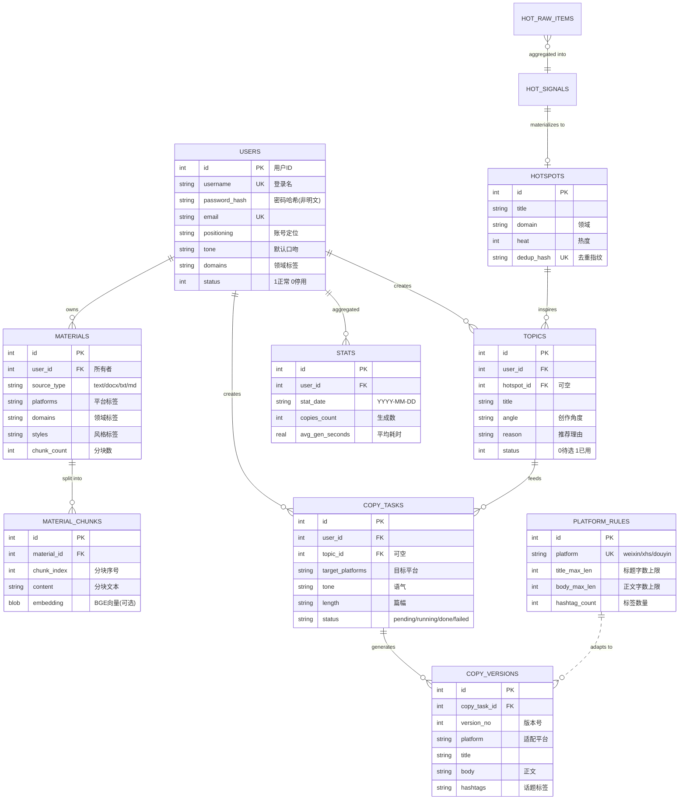

# AI 自媒体内容创作助手 — 数据库设计

> 版本：V1.1.0 ｜ 对应项目计划书 V1.0.0 第四章 4.2 数据库设计
> 交付物归属：M1 需求与方案设计 → T1.3 数据库设计
> 存储引擎：SQLite 3（业务数据） + FAISS 索引文件（向量，见设计决策）
> 修订：V1.2.0（2026-10-26 P2-7 采纳埋点 — 由 13 张表扩为 **14 张**：新增 `hot_feed_event`（曝光/采纳/出题三级漏斗 + 索引 2 个）；`hotspots` 不改列，`adopted` 由 EXISTS 子查询实时判定）；V1.1.0（2026-10-22 热点采集 V2 — 由 9 张表扩为 **13 张**：新增 `hot_raw_items` / `hot_signals` / `hot_source_state` / `hot_collect_log`，`hotspots` 降级为 `hot_signals` 的物化宽表并补 8 列）；V1.0.2（M2 复查 — 落实字段级加密与口令哈希：新增 db/security.py，materials.content / material_chunks.content 入库前 Fernet 加密，password_hash 改 pbkdf2 加盐哈希）；V1.0.1（评审修订 — 补充平台规则引用方式、关键词检索限制、全局统计行语义三条设计说明）

## 1. 概述

本设计覆盖计划书定义的 **9 张核心表**，并在 V1.1.0 因热点采集改造新增 **4 张**（三层热点模型 + 来源状态 + 采集日志），合计 **13 张**，支撑六大功能模块（F1–F6）的持久化需求：

| 表 | 中文名 | 服务的模块 |
|---|---|---|
| `users` | 用户与账号人设 | F6 用户与系统管理 |
| `materials` | 素材 | F1 素材库与热点 |
| `material_chunks` | 素材分块 | F1 素材库与热点（向量化） |
| `hot_raw_items` | 原始采集条目（追加式） | F1 热点三层模型 |
| `hot_signals` | 热点聚合信号（跨源合并 + 归一化） | F1 热点三层模型 |
| `hot_source_state` | 来源健康状态（熔断退避） | F1 热点采集运维 |
| `hot_collect_log` | 采集日志（成功率/P95 唯一来源） | F1 热点采集运维 |
| `hotspots` | 热点物化宽表（供 F2 读取） | F1 素材库与热点 / F2 选题 |
| `hot_feed_event` | 推荐流事件（曝光/采纳/出题） | F1 热点看板（采纳率与「已用过」） |
| `topics` | 选题 | F2 选题策划 |
| `copy_tasks` | 创作任务 | F3/F4/F5 文案生成链路 |
| `copy_versions` | 文案版本 | F3/F4/F5 多版本与适配 |
| `platform_rules` | 平台规则 | F5 多平台适配 |
| `stats` | 统计 | F6 系统管理 |

## 2. ER 关系图



## 3. 表结构详细说明

### 3.1 users — 用户与账号人设（F6）
| 字段 | 类型 | 约束 | 说明 |
|---|---|---|---|
| id | INTEGER | PK AUTOINCREMENT | 用户 ID |
| username | TEXT | NOT NULL UNIQUE | 登录名 |
| password_hash | TEXT | NOT NULL | bcrypt/argon2 哈希，**绝不存明文** |
| email | TEXT | UNIQUE | 邮箱（可选） |
| display_name | TEXT | | 展示名 |
| positioning | TEXT | | 账号定位 |
| tone | TEXT | | 默认口吻（专业/轻松/犀利…） |
| domains | TEXT | | 领域标签，逗号分隔 |
| created_at / updated_at | TEXT | DEFAULT now | 时间戳（ISO8601） |
| status | INTEGER | DEFAULT 1 | 1=正常 0=停用 |

### 3.2 materials — 素材（F1）
| 字段 | 类型 | 约束 | 说明 |
|---|---|---|---|
| id | INTEGER | PK | 素材 ID |
| user_id | INTEGER | FK→users ON DELETE CASCADE | 所有者 |
| title | TEXT | | 素材标题 |
| source_type | TEXT | DEFAULT 'text' | text/docx/txt/md |
| content | TEXT | | 清洗后正文（敏感内容按规则脱敏） |
| file_path | TEXT | | 原始文件落盘路径 |
| platforms / domains / styles | TEXT | | 平台/领域/风格标签，逗号分隔 |
| custom_tags | TEXT | | 自定义标签 |
| char_count / chunk_count | INTEGER | DEFAULT 0 | 字符数 / 分块数 |

### 3.3 material_chunks — 素材分块（F1）
| 字段 | 类型 | 约束 | 说明 |
|---|---|---|---|
| id | INTEGER | PK | 分块 ID |
| material_id | INTEGER | FK→materials ON DELETE CASCADE | 所属素材 |
| chunk_index | INTEGER | 联合 UNIQUE(material_id,chunk_index) | 分块序号 |
| content | TEXT | NOT NULL | 分块文本 |
| embedding | BLOB | 可空 | BGE 向量；**FAISS 为主存储**，此列便于切换到 Chroma |
| char_count | INTEGER | DEFAULT 0 | 分块字符数 |

### 3.4 热点三层模型（V1.1.0 重构）

原单表 `hotspots` 同时承担"原始采集 / 跨源去重 / 展示排序"，导致三个无解问题：热度跨源不可比、跨平台同话题重复、老热点永不下架。故拆为三层：

```
hot_raw_items（追加式原始层） → hot_signals（聚合层） → hotspots（物化宽表）
```

> **两层去重是分工，不是矛盾**：raw 层跨平台同名**各自保留**（保真、可算覆盖度）；signal 层同一话题**有意合并**（趋势识别的价值）。禁止在 raw 层做跨源合并，也禁止在 signal 层保留同话题多行。

#### 3.4.1 hot_raw_items — 原始采集条目
| 字段 | 类型 | 约束 | 说明 |
|---|---|---|---|
| id | INTEGER | PK | |
| source_code | TEXT | NOT NULL | 热榜来源码 `weibo/zhihu/baidu/douyin/bilibili/toutiao` |
| title | TEXT | NOT NULL | 原样标题，**不做归一化** |
| summary | TEXT | 可空 | 源提供的摘要 |
| url | TEXT | | 原链 |
| rank | INTEGER | | 榜单内排名（1-based） |
| raw_heat | INTEGER | | 原始热度，**仅同源内可比，禁止跨源排序** |
| batch_id | TEXT | NOT NULL | 采集批次，秒级 `20261022T095003` |
| fetched_at | TEXT | NOT NULL | 抓取时间 |
| — | — | UNIQUE(source_code,title,batch_id) | 同批次同源同标题只留一条 |

索引：`idx_hot_raw_lookup(source_code,title,fetched_at)`、`idx_hot_raw_batch(batch_id)`

#### 3.4.2 hot_signals — 聚合信号
| 字段 | 类型 | 约束 | 说明 |
|---|---|---|---|
| id | INTEGER | PK | |
| canonical_key | TEXT | NOT NULL UNIQUE | `sha256(归一化标题)`；跨源合并的落点 |
| canonical_title | TEXT | NOT NULL | 取覆盖源中 **rank 最优**的原题 |
| summary | TEXT | | 首条非空摘要；全空兜底「{来源名}热榜话题」，**禁止 NULL** |
| source_count / sources | INTEGER / TEXT | | 当前覆盖来源数与来源码列表 |
| best_rank / prev_best_rank | INTEGER | | 跨源最优排名 / 上轮值（算 trend） |
| best_raw_heat | INTEGER | | 最优排名那条的原始热度（物化到 `hotspots.heat`） |
| norm_heat / prev_norm_heat | REAL | 0–100 | 归一化热度 / 上轮值 |
| trend | TEXT | | 上升 / 平稳 / 下降 |
| main_domain | TEXT | | 关键词表判定的主领域；未命中为「综合」 |
| first_seen_at / last_seen_at | TEXT | NOT NULL | 首次上榜 / 最近在榜（**退榜判据**） |
| suggestion / suggestion_at | TEXT | | 切入建议（二期惰性生成） |

索引：`idx_hot_signals_last_seen`、`idx_hot_signals_heat`、`idx_hot_signals_domain`

#### 3.4.3 hot_source_state — 来源健康状态
| 字段 | 类型 | 说明 |
|---|---|---|
| source_code | TEXT PK | 来源码 |
| last_ok_at / last_error | TEXT | 最近成功时间 / 最近错误 |
| fail_streak | INTEGER | 连续失败次数（≥3 进入退避） |
| backoff_until | TEXT | 该时刻前不再请求该源 |
| total_fetched | INTEGER | 累计入库条数 |

#### 3.4.4 hot_collect_log — 采集日志
| 字段 | 类型 | 说明 |
|---|---|---|
| batch_id / source_code | TEXT | 批次 + 来源 |
| ok | INTEGER | 1 成功 / 0 失败 |
| item_count / elapsed_ms | INTEGER | 条数 / 耗时 |
| error | TEXT | 失败原因 |

索引：`idx_hot_collect_log_batch(batch_id, source_code)`。**"采集成功率 ≥95%""P95 ≤5s" 的唯一数据来源**——没有这张表，指标就是空口数字。

#### 3.4.5 hotspots — 物化宽表
| 字段 | 类型 | 约束 | 说明 |
|---|---|---|---|
| id | INTEGER | PK | 热点 ID |
| signal_id | INTEGER | FK→hot_signals ON DELETE SET NULL | 物化来源 |
| title / summary / source / url | TEXT | | 标题 / 摘要 / 展示来源名 / 链接 |
| platform | TEXT | | **热榜来源码**（≠ 发布平台码） |
| domain | TEXT | | 主领域；未命中为「综合」 |
| heat | INTEGER | DEFAULT 0 | 原始热度，**仅为兼容前端契约保留，不参与排序** |
| norm_heat | REAL | DEFAULT 0 | 0–100 归一化热度（排序主用） |
| source_count / trend / first_seen_at / is_new | | | 覆盖源数 / 趋势 / 首次上榜 / 是否新上榜 |
| suggestion | TEXT | | 切入建议 |
| dedup_hash | TEXT | UNIQUE | = `hot_signals.canonical_key` |
| collected_at / is_active | | | 物化时间 / 是否在榜（退榜置 0，**不删行**以保外键） |

#### 3.4.6 hot_feed_event — 推荐流事件（P2-7）
| 字段 | 类型 | 约束 | 说明 |
|---|---|---|---|
| id | INTEGER | PK | 事件 ID |
| user_id | INTEGER | NOT NULL, FK→users ON DELETE CASCADE | 谁 |
| action | TEXT | NOT NULL | `expose` 曝光（分母）/ `adopt` 采纳（弱信号）/ `generate` 出题（强信号，服务端写） |
| hotspot_id | INTEGER | **无外键** | 哪条热点；故意不建 FK——历史采纳记录不该随热点清理消失 |
| signal_id | INTEGER | | 聚合层 id（跨源合并后仍唯一） |
| surface | TEXT | | 来自哪个视图：`feed` / `all` / `platform` / `topics` |
| position | INTEGER | | 点击时在列表中的名次（用来看位置偏差） |
| item_count | INTEGER | DEFAULT 0 | `expose` 时本次渲染条数；其余动作记 1 |
| domain | TEXT | | 冗余领域，便于按领域切漏斗 |
| created_at | TEXT | NOT NULL | **显式写本地时间**（DEFAULT 用 UTC 会让"近 7 天"窗口整体偏 8 小时） |

> 为什么单列一张表而不是在 `hotspots` 上加 `adopted` 列：采纳是**每用户**的状态，不是热点的属性；且一个用户可能对同一热点多次采纳（隔天复写），需要留历史才能算漏斗。

### 3.5 topics — 选题（F2）
| 字段 | 类型 | 约束 | 说明 |
|---|---|---|---|
| id | INTEGER | PK | 选题 ID |
| user_id | INTEGER | FK→users ON DELETE CASCADE | 所属用户 |
| hotspot_id | INTEGER | FK→hotspots ON DELETE SET NULL | 关联热点（可选） |
| title | TEXT | NOT NULL | 选题标题 |
| angle | TEXT | | 创作角度 |
| reason | TEXT | | 推荐理由（逐条标注） |
| target_audience | TEXT | | 目标受众（逐条标注） |
| status | INTEGER | DEFAULT 0 | 0=待选用 1=已选用进入创作 |

### 3.6 copy_tasks — 创作任务（F3/F4/F5）
| 字段 | 类型 | 约束 | 说明 |
|---|---|---|---|
| id | INTEGER | PK | 任务 ID |
| user_id | INTEGER | FK→users ON DELETE CASCADE | 发起人 |
| topic_id | INTEGER | FK→topics ON DELETE SET NULL | 关联选题（可选） |
| selected_materials | TEXT | | 选用素材 id 列表（JSON） |
| target_platforms | TEXT | | 目标平台，逗号分隔 |
| target_audience | TEXT | | 目标受众 |
| creation_intent | TEXT | | 创作意图 |
| tone | TEXT | | 语气（专业/轻松/犀利） |
| length | TEXT | | 篇幅（短/中/长） |
| persona_voice | TEXT | | 人设口吻 |
| status | TEXT | DEFAULT 'pending' | pending/running/done/failed |
| error_msg | TEXT | | 失败原因（便于重试/补偿） |
| finished_at | TEXT | | 完成时间 |

### 3.7 copy_versions — 文案版本（F3/F4/F5）
| 字段 | 类型 | 约束 | 说明 |
|---|---|---|---|
| id | INTEGER | PK | 版本 ID |
| copy_task_id | INTEGER | FK→copy_tasks ON DELETE CASCADE | 所属任务 |
| version_no | INTEGER | 联合 UNIQUE(task,version) | 版本号（≥3） |
| platform | TEXT | | 适配平台 |
| title / body | TEXT | | 标题 / 正文 |
| hashtags | TEXT | | 话题标签（逗号/JSON） |
| tone | TEXT | | 语气 |
| style_consistency | TEXT | | 风格一致性报告 |
| replacement_suggestions | TEXT | | 同质化替换建议 |

### 3.8 platform_rules — 平台规则（F5）
| 字段 | 类型 | 约束 | 说明 |
|---|---|---|---|
| id | INTEGER | PK | 规则 ID |
| platform | TEXT | NOT NULL UNIQUE | weixin/xhs/douyin/… |
| display_name | TEXT | | 平台中文名 |
| title_max_len | INTEGER | | 标题字数上限 |
| body_max_len | INTEGER | | 正文字数上限（NULL=不限制） |
| hashtag_format | TEXT | | 标签格式模板（如 `#话题#`） |
| hashtag_count | INTEGER | | 标签数量上限 |
| layout_style | TEXT | | 排版样式说明 |
| export_format | TEXT | | 导出格式（txt/docx） |
| is_active | INTEGER | DEFAULT 1 | 是否启用 |

> 种子数据：微信公众号（标题≤64，docx）、小红书（标题≤20，正文≤1000，标签≤10，txt）、抖音（标题≤30，正文≤200，标签≤5，txt）。

### 3.9 stats — 统计（F6）
| 字段 | 类型 | 约束 | 说明 |
|---|---|---|---|
| id | INTEGER | PK | 统计 ID |
| user_id | INTEGER | FK→users ON DELETE CASCADE | 用户（可空=全局） |
| stat_date | TEXT | 联合 UNIQUE(user,date) | 统计日期 YYYY-MM-DD |
| materials_count / topics_count / copies_count | INTEGER | DEFAULT 0 | 素材/选题/文案计数 |
| avg_gen_seconds | REAL | DEFAULT 0 | 平均生成耗时（秒） |
| updated_at | TEXT | DEFAULT now | 更新时间 |

## 4. 索引设计

> V1.2.0 后共 **20 个** `idx_*` 索引（原 9 个 + 热点三层净增 9 个 + 推荐流事件 2 个），`db/init_db.py` 断言 `>= 20`。

| 索引 | 表 | 列 | 用途 |
|---|---|---|---|
| idx_materials_user | materials | user_id | 用户维度素材检索 |
| idx_chunks_material | material_chunks | material_id | 素材→分块回溯 |
| idx_hotspots_domain | hotspots | (domain, is_active) | 按领域筛选热点（F2 取热点） |
| idx_hotspots_platform | hotspots | (platform, is_active) | 按热榜来源筛选 |
| idx_hotspots_active_heat | hotspots | (is_active, norm_heat) | 在榜热点按归一化热度排序 |
| idx_hot_raw_lookup | hot_raw_items | (source_code, title, fetched_at) | 来源内标题回溯与去重核查 |
| idx_hot_raw_batch | hot_raw_items | batch_id | 按批次聚合与清理 |
| idx_hot_signals_last_seen | hot_signals | last_seen_at | 退榜扫描（TTL） |
| idx_hot_signals_heat | hot_signals | norm_heat | 热度排序 |
| idx_hot_signals_domain | hot_signals | (main_domain, last_seen_at) | 领域内取在榜信号 |
| idx_hot_feed_event_user | hot_feed_event | (user_id, created_at) | 取「我采纳过哪些」→ 看板「已用过」标记 |
| idx_hot_feed_event_action | hot_feed_event | (action, created_at) | 近 N 天采纳漏斗（按动作聚合） |
| idx_hot_collect_log_batch | hot_collect_log | (batch_id, source_code) | 成功率与 P95 统计 |
| idx_topics_user | topics | user_id | 用户选题列表 |
| idx_topics_hotspot | topics | hotspot_id | 热点→选题关联 |
| idx_copy_tasks_user | copy_tasks | user_id | 用户创作任务列表 |
| idx_copy_tasks_topic | copy_tasks | topic_id | 选题→任务回溯 |
| idx_copy_versions_task | copy_versions | copy_task_id | 任务→多版本对比 |
| idx_copy_versions_platform | copy_versions | platform | 按平台匹配 platform_rules 适配检索 |
| idx_stats_user_date | stats | (user_id, stat_date) | 运营数据聚合 |

## 5. 关键设计决策

1. **向量与主存储分离**：`material_chunks.embedding` 仅作可选备份；生产环境向量由 **FAISS** 承载（计划书 3.1/4.5），sqlite 存分块文本与元数据，二者通过 `chunk_id` 对齐。切换 Chroma 时可直接启用 `embedding` 列。
2. **敏感字段处理（落实计划书 2.2.4 / 4.2）**：新增 `db/security.py` 统一实现——`password_hash` 采用 **pbkdf2_hmac(sha256, 260000 轮) 加盐哈希**（格式 `$pbkdf2$iter$salt$hash`），绝不存明文；`materials.content` 与 `material_chunks.content` 落库前经 **Fernet 字段级加密**（密文前缀 `enc:`），密钥来自环境变量 `DB_FIELD_KEY`，缺失时回退项目根 `.env` 中的演示密钥，生产必须设环境变量且密钥不入库；API Key 同样不入库，仅经环境变量注入。
3. **级联策略**：用户删除 → 素材/分块/选题/任务/统计级联清除（CASCADE）；选题/热点被删 → 关联任务置 NULL（SET NULL），保留历史文案不丢失。
4. **热点去重与生命周期（V1.1.0 重构）**：三层各司其职——raw 层用 `(source_code,title,batch_id)` 唯一约束防重复抓取；signal 层用 `canonical_key`（归一化标题指纹）做**跨源合并**；物化层 `hotspots.dedup_hash` 唯一约束配合 upsert 保证行数不增长。退榜由 `last_seen_at + TTL` 驱动（置 `is_active=0`，不删行以保 `topics.hotspot_id` 外键）。**注意**：不得再用 `sha256(title|固定来源名)` 作为去重键——那等价于只按标题去重，且标题一变就新增一行。
5. **平台规则外置**：`platform_rules` 可配置、可扩展（新增平台只需插一行），满足"配置项外置、便于运维调整"（计划书 2.2.5）。
6. **多版本与适配**：`copy_versions` 一次任务产出 ≥3 版本，按 `platform` 字段区分适配结果，支撑 F5 一键多端分发。

## 5.1 评审补充设计说明

7. **平台规则引用方式**：`copy_versions.platform` 存平台代码字符串（weixin/xhs/douyin），与 `platform_rules.platform` 为**逻辑关联而非外键约束**；适配时按代码匹配规则。建议对 `copy_versions(platform)` 建索引以加速按平台检索（已在 `idx_copy_versions_task` 之外按需补充，见 `schema.sql` 注释）。
8. **关键词检索限制**：语义检索由 FAISS 承载；关键词检索当前依赖 `LIKE` 对 `materials.content` / `material_chunks.content` 的匹配（未建 FTS 虚拟表）。素材量增长后建议引入 SQLite FTS5 提升关键词检索性能与召回。
9. **全局统计行语义**：`stats.user_id` 可为 NULL 表示全局聚合；因 SQLite 将 NULL 视为互异，同一日期允许多条全局行，写入时应以 `(user_id, stat_date)` 做 upsert 去重，避免重复计数。

## 6. 与计划书条款对照

| 计划书条款 | 本设计落实 |
|---|---|
| 4.2 数据库设计（9 张核心表） | 9 张表字段设计草案 + 热点改造新增 4 张（共 13 张）→ 落地为可执行 DDL |
| 2.1.6 用户认证 JWT / 人设配置 | users 表含 password_hash + positioning/tone/domains |
| 2.1.1 自动分块与向量化 | material_chunks 表 |
| 2.1.1 热点采集去重 | 三层去重：raw `(source_code,title,batch_id)` + signal `canonical_key` + hotspots `dedup_hash` |
| 2.1.2 选题+理由+受众 | topics 表（angle/reason/target_audience） |
| 2.1.3 ≥3 版本文案 | copy_tasks + copy_versions(version_no) |
| 2.1.5 多平台适配 | platform_rules + copy_versions.platform |
| 2.2.4 敏感字段加密 | pbkdf2 口令哈希 + Fernet 字段级加密（db/security.py）+ Key 不入库 |

## 7. 运行与验证

```bash
# 生成数据库（首次）
python init_db.py
# 重建（会删除旧库）
python init_db.py --reset
# 仅校验 schema 可建库并跑通外键/索引/级联/去重（用临时库，不落盘）
python init_db.py --check
```

交付文件：
- `db/schema.sql` — 可执行 SQLite DDL（含索引 + 平台规则种子数据）
- `db/init_db.py` — 初始化与自检脚本（标准库，无第三方依赖）
- `db/app.db` — 已初始化的数据库实例（可直接被 FastAPI 连接）
