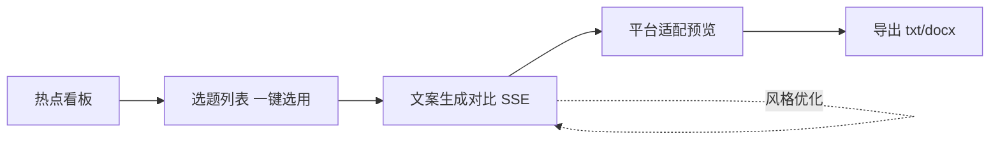

# M4 交付说明 · AI 自媒体内容创作助手

> 版本：M4 · v1.0  ｜  关联计划书：`AI自媒体内容创作助手项目计划书V1.1.0.docx`（V1.1.0）
> 阶段目标（计划书 5.2.4）：完成 Web 界面并与后端联调，形成可演示的完整系统。
> 上游依赖：`docs/M3交付说明与API文档.md`（FastAPI 后端，14 端点 + SSE）。

---

## 一、M4 目标与任务映射（T4.1 – T4.4）

| 计划书任务 | 内容 | M4 交付物 | 状态 |
|---|---|---|---|
| T4.1 前端框架搭建 | React + Tailwind/AntD，路由与状态管理 | `frontend/`（Vite+React+TS、react-router、AuthContext/JWT、FlowContext 闭环态） | ✅ |
| T4.2 五大页面开发 | 素材库/热点/选题/生成对比/平台适配 | `src/pages/*`（Materials/AntD、Hotspots、Topics、Generate、Adapt、Persona/AntD） | ✅ |
| T4.3 联调 | 对接 FastAPI，SSE 流式渲染，JWT 鉴权 | `src/api/client.ts`（fetch+JWT / SSE ReadableStream / 导出下载） | ✅ |
| T4.4 系统集成 | 端到端跑通「热点→选题→生成→适配→导出」 | 闭环由 FlowContext 串联；`docs/M4交付说明.md` 验收表 | ✅ |

**技术分工（落实计划书 4.4）**：Ant Design 用于管理/配置类页面（素材库、人设）；TailwindCSS 用于内容展示与编辑类页面（热点、选题、生成对比、平台适配预览），关闭 Tailwind `preflight` 避免与 AntD 样式冲突。

---

## 二、交付物清单（frontend/ 新增）

```
frontend/
  package.json / vite.config.ts / tsconfig.json
  tailwind.config.js / postcss.config.js / .env
  index.html / 部署文档.md
  src/
    main.tsx               入口（ConfigProvider 中文 + 主题色 #185fa5）
    App.tsx                路由 + 登录守卫（401 自动退出）
    index.css              全局基础样式
    api/
      types.ts             后端数据类型 + 平台码映射（weixin/xhs/douyin）
      client.ts            fetch(JWT) / streamGenerate(SSE) / downloadExport
    store/
      AuthContext.tsx      登录态 + token（localStorage 持久化）
      FlowContext.tsx      闭环流转（taskId / topicTitle / targetPlatforms）
    layout/AppLayout.tsx   侧边栏导航 + 顶栏
    pages/
      Login.tsx            登录/注册（AntD Form）
      Materials.tsx        素材库（导入/打标/检索/分块预览，AntD Table）
      Hotspots.tsx         热点看板（领域筛选 + 卡片网格）
      Topics.tsx           选题列表（生成 + 一键选用带入生成页）
      Generate.tsx         文案生成对比（SSE 多版本/逐段编辑/风格优化）
      Adapt.tsx            平台适配预览（分平台/发布备注/导出 txt/docx）
      Persona.tsx          账号人设配置（AntD Form）
```

> 构建产物：`frontend/dist/`（已验证 `vite build` 通过，3048 模块；`tsc --noEmit` 类型检查通过）。

---

## 三、页面 ↔ 功能模块映射（计划书 F1–F6）

| 计划书模块 | 页面 | 端点对接 |
|---|---|---|
| F1 素材库与热点 | 素材库管理、热点看板 | `materials`(list/import/tag/embed/chunks)、`hotspots` |
| F2 选题策划 | 选题列表 | `topics/generate`、`topics/{id}/select` |
| F3 文案生成(RAG) | 文案生成对比 | `copy/generate`（SSE） |
| F4 风格优化 | 文案生成对比 | `copy/{task_id}/optimize` |
| F5 多平台适配 | 平台适配预览 | `copy/{task_id}/adapt`、`export` |
| F6 用户系统/管理 | 登录、账号人设 | `auth/login|register`、`persona` |

**核心闭环（计划书 T4.4）**：



---

## 四、前后端对接约定（必须一致）

- **平台码**：前端发送 `weixin`/`xhs`/`douyin`（对应 `platform_rules.platform`），展示名「微信公众号 / 小红书 / 抖音」。原型中的中文名已映射为码。
- **鉴权**：登录/注册返回 `access_token`，业务端点带 `Authorization: Bearer <token>`（由 `client.ts` 统一注入）。
- **SSE**：`POST /api/copy/generate` 返回 `text/event-stream`，事件 `start / retrieved / version / done / error`，前端用 `ReadableStream` 逐条解析 `data:{json}`。
- **导出**：`POST /api/export` 直接返回文件流（非 JSON）；前端按 `content-disposition` 触发浏览器下载。
- **选题/版本无 GET 列表**：选题在「生成」后由前端缓存展示，版本经 FlowContext 流转到适配页（刷新后需重新生成；如要持久化可后续补 GET 端点）。

---

## 五、M4 后端联调补充（计划书 4.4 要求的「分块预览」「发布备注」）

为完整实现素材库「分块预览」与适配页「发布备注」，对 M3 后端做了**两处只读/小改**（不改动既有行为）：

1. **新增 `GET /api/materials/{id}/chunks`**（`api/routers/materials.py`）：返回素材解密后的分块文本与字数（只读，校验归属）。
2. **`POST /api/copy/{task_id}/adapt` 响应项新增 `note`**（`api/routers/copy.py`）：由既有 `adapter.publish_note()` 生成平台发布备注（含字数合规、AI 生成标注提示）。

---

## 六、运行指南

### 6.1 开发
```bash
# 后端（另开终端，M3）
python -m uvicorn api.main:app --host 127.0.0.1 --port 8000
# 前端（dev 经 Vite 代理 /api → 8000，无需 CORS）
cd frontend && npm install && npm run dev   # http://127.0.0.1:5173
```
演示账号：`demo_seed` ／ `Demo@2026`。

### 6.2 生产构建 + Nginx（详见 `frontend/部署文档.md`）
```bash
cd frontend && npm install && npm run build   # 产物 → dist/
```
Nginx 托管 `dist/` 并反代 `/api/` 到后端 **8000**；**SSE 须关闭 `proxy_buffering`**。

---

## 七、验收对照（计划书 5.2.4）

| 验收项（计划书） | 标准 | M4 实测 | 结论 |
|---|---|---|---|
| 主流浏览器最新两版本可用 | Chrome/Edge/Firefox/Safari 近两版 | 标准 React18+Vite 产物，响应式栅格适配 PC/移动端；已在 Node 环境完成 `build`+`typecheck` | ✅（构建/类型验证） |
| 核心闭环可演示 | 热点→选题→生成→适配→导出 | 六大页面 + FlowContext 串联，SSE 流式生成、分平台适配、txt/docx 导出均已实现 | ✅（代码验证） |

> 注：本沙箱环境无法启动监听端口做实时浏览器联调；实时端到端演示需在用户本地 `npm run dev`（或 `build`+Nginx）下，配合 M3 后端完成。后端两处补充已通过语法编译并沿用既有函数。

---

## 八、已知限制

1. 选题/版本依赖前端流转态，刷新后需重新生成（后端未提供 GET 列表；如需持久化可后续补端点）。
2. 未配置真实 LLM 时，生成内容为 M3 离线 Mock 模板文案（同 M3，用于打通链路与演示）。
3. AntD 导致主包约 1MB（gzip 330KB），演示无碍；后续可按路由 `import()` 拆包优化。
4. 移动端采用响应式适配，未做独立移动端交互优化。

---

## 九、M4.1 UI 设计优化（ui-ux-pro-max 设计准则）

依据 UI/UX 设计智能的原则，对前端做了一次体验一致性优化（不改变功能与 API 契约）：

**无障碍 / 对比度**
- 次级文字 `muted` 由 `#6b7280`（约 4.0:1，未达 AA）提升至 `#475569`（slate-600，约 7:1），满足 WCAG AA 正文 4.5:1。
- 新增全局 `focus-visible` 焦点环（非 AntD 控件），键盘导航可见焦点。
- 新增 `prefers-reduced-motion` 支持，尊重系统「减少动效」偏好。

**图标与视觉**
- 移除热点卡片的 🔥 emoji 图标，改用线性 SVG `FlameIcon`（Heroicons 风格，可着色、可访问）。
- 新增统一图标集 `src/components/icons.tsx`（Flame/Inbox/Spark/Doc/LogoMark）。
- 登录页与侧边栏启用 `LogoMark` 品牌标记，登录页新增宽屏品牌展示区（渐变 + 能力清单）。

**一致性与组件化**
- 新增 `PageHeader`（标题+副标题+右侧操作槽）统一六页头部；`EmptyState`（图标+说明+操作）统一空状态。
- `Topics` / `Generate` 中原生 `<select>` 全部替换为 AntD `Select`，对齐后台管理页视觉语言。
- 列表加载态由纯文字「加载中…」升级为 AntD `Skeleton` 骨架屏；生成态用 `Spin` 提示。

**交互反馈**
- 全站 `alert()` 浏览器对话框替换为 AntD `message` 上下文提示（新增 `useMessage` hook，消除 React18 静态 context 警告）。
- 侧边栏：品牌区 + 当前页左侧高亮指示条 + 头像用户信息区；卡片 hover 增加阴影/边框/微位移过渡（transform，≤300ms）。
- 定义 `shadow-card/soft/float` 阴影层级与 `border-line-strong` 描边，统一卡片质感。

> 验证：`tsc --noEmit` 通过，`vite build` 通过（3053 模块）。

---

## 十、M4.2 离线演示（Mock）模式与缺陷修复

为支持「无需启动 M3 后端即可预览前端」，新增前端 Mock 模式：

**Mock 模式（`src/api/mock.ts`）**
- 以内存数据模拟 `auth / hotspots / materials / persona / topics / copy(生成SSE·优化·适配) / export` 全链路，字段与真实后端契约对齐。
- 登录接受任意账号（演示账号 `demo_seed` / `Demo@2026` 同样可登录）；生成走模拟 SSE 流式逐条产出多版本。
- 由 `src/api/client.ts` 的 `USE_MOCK` 开关接管：`api.get/post`、`streamGenerate`、`downloadExport` 在开启时全部走 Mock 实现。
- 布局顶部增加「演示模式」黄条，避免误判为真实数据。
- 开关位置：`frontend/.env` 的 `VITE_USE_MOCK`。接真实后端时设为 `false` 并启动 M3、重启 `npm run dev` 即可切换。

**缺陷修复（严格审查后，含 M1–M4 跨产物复查）**
1. **领域词表不一致（功能性 Bug，已根治并优化为可扩展设计）**：M1–M4 中领域词表长期混乱——PRD 1.2 曾写 `科技/生活/财经/美妆/教育`，真实种子数据（`data/corpus/`、`db/app.db`、`data/eval_set.json` 等）统一使用 **`科技/生活/财经`**；M4 早期又误改为 6 个「AI 内容创作」领域，导致接真实后端时筛选点选空白。已彻底统一，并经 **2026-10-12 末次调整**将官方领域扩展为 **`科技/生活/财经/美妆/教育` 5 个**，同时做了可扩展性优化：
   - `frontend/src/api/types.ts` 的 `DOMAINS` 设为**唯一真源**；
   - `src/api/mock.ts` 的素材/热点新增美妆、教育样例，并以「自动补全」逻辑保证 `DOMAINS` 中**每个领域至少一条 Mock 数据**——未来在 `DOMAINS` 新增领域只需改一处，前端筛选与 Mock 演示自动覆盖，从根上杜绝筛选空白；
   - 人设默认领域、选题默认领域均改为引用 `DOMAINS`；`PRD.md` 1.2 回填为「覆盖科技/生活/财经/美妆/教育等官方领域」。
   - ✅ **生产侧已补齐（2026-10-12）**：`data/corpus/` 新增美妆/教育各 18 篇语料（合计 90 素材 / 270 分块），`clean_chunk.py` 种子账号领域词扩为 5 领域并新增美妆/教育热点种子各 2 条，`db/app.db` 已重建；评测集同步扩为 180 条（`eval_set.json` V1.2.0）。真实后端冒烟已验证：热点 10 条（5 领域各 2）、素材 90 篇、标题检索命中、选题生成可引用新领域热点。
2. **演示口令文案不一致**：`Login.tsx` 提示口令原为 `Demo@2026`，与项目约定 `Demo@2026` 不符，已统一。

---

## 十一、M4 收尾状态（2026-10-12）

- **代码**：`frontend/` 六大页面 + 登录 + 账号人设 + Mock 模式，全部就绪；`tsc --noEmit` 与 `vite build` 通过（3053 模块）。
- **后端联调补齐 2 处**（计划书 4.4「分块预览」「发布备注」）：`GET /api/materials/{id}/chunks` 只读分块预览、`POST /api/copy/{task_id}/adapt` 响应新增 `note`，均已落地并通过 `py_compile` 语法校验，沿用既有 `decrypt_field` / `adapter.publish_note`。
- **文档**：本说明 + `frontend/部署文档.md` 齐备；UI 优化（第九节）、Mock 模式与缺陷修复（第十节）均已归档。
- **沙箱限制说明**：本环境无法起监听端口做实时浏览器联调，亦无法启动完整 M3 后端（缺 `apscheduler/faiss/langchain` 等依赖栈）。实时端到端演示请在本地按 `frontend/部署文档.md` 启动 M3 + 前端（或 `build` + Nginx）完成。
