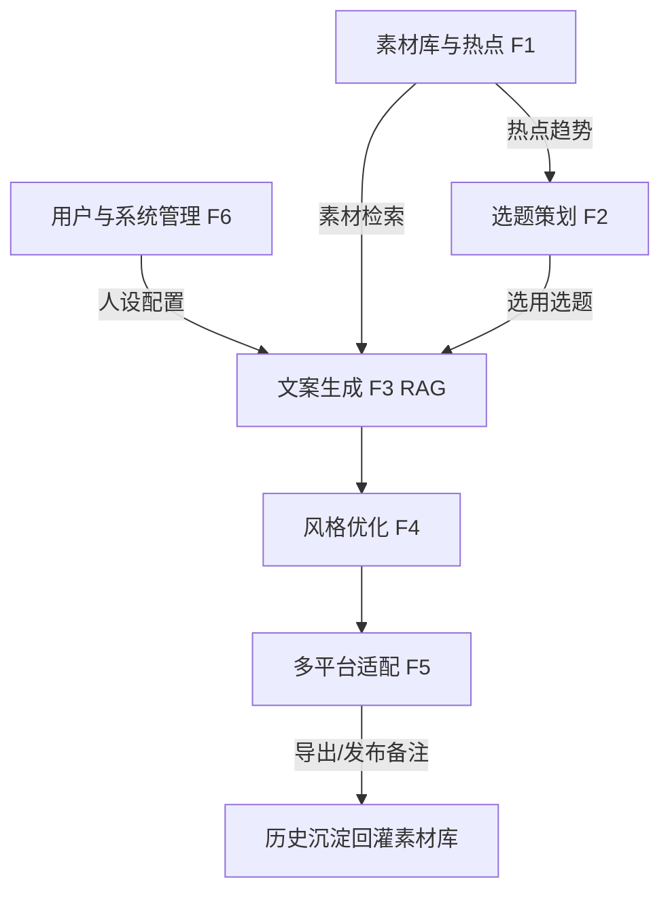

# AI 自媒体内容创作助手 — 产品需求文档（PRD）

> 版本：V1.1.2 ｜ 对应项目计划书 V1.0.0 第二章 需求分析 + 第五章 M1
> 交付物归属：M1 需求与方案设计 → T1.1 需求调研与确认 / T1.2 系统架构设计
> 基线：以《项目任务书 V1.0.0》为唯一需求基线
> 修订：
> - V1.0.1（评审修订 — 修正 1.4 功能模块地图悬空节点 `ALL`，人设配置改为正确流入 F3 文案生成）
> - V1.1.0（2026-10-22 — **F1.4 需求基线变更**，见 §6 变更说明。原"定时采集并去重"升级为"自动分源采集 + 跨源聚合 + 个性化推荐流 + 退榜机制"；新增 `POST /hotspots/refresh` 与 `GET /hotspots/status` 两个端点，端点数 16 → 18）
> - V1.1.1（2026-10-26 — **F1.4 / F2.1 验收补充**，见 §7.5 二期补充。热点从"能看"补齐到"能用"：每条给出可执行的切入建议角度，并可一键直传选题；展示口径由原始热度改为归一化热度 + 榜内名次）
> - V1.1.2（2026-10-26 — **北极星指标可观测**，见 §8.4。新增 `POST /hotspots/events` 与 `hot_feed_event` 表，把 §8.3 定义的采纳率真正落了地（曝光/采纳/出题三级漏斗）；端点 18 → 19；顺带把采纳记录变成用户可见的「已用过」标记）

## 1. 产品概述

### 1.1 产品定位
面向自媒体创作者的 AI 内容创作助手 Web 应用，形成"热点感知—选题策划—文案生成—多平台适配"的创作闭环，将单篇内容创作从小时级压缩到分钟级。

### 1.2 目标用户
- 个人自媒体博主、小团队内容运营者、MCN 机构运营岗
- 覆盖科技 / 生活 / 财经 / 美妆 / 教育 等官方领域。领域词表以 `frontend/src/api/types.ts` 的 `DOMAINS` 为唯一真源，后续新增领域仅需修改该常量，前端筛选与 Mock 演示数据即自动覆盖；生产语料（`data/corpus/` + `db/app.db` 播种）当前已含全部 5 领域（各 18 篇素材），新增领域需同步补语料并重新播种
- 运营平台：公众号、小红书、抖音等

### 1.3 典型场景
| 场景 | 描述 |
|---|---|
| 日常创作 | 登录 → 浏览热点看板 → 选用推荐选题 → 一键生成 3+ 版本 → 调参适配目标平台 → 导出 |
| 人设沉淀 | 导入往期爆款与行业资料 → 系统自动打标/分块/向量化 → 后续生成风格与历史一致 |
| 多端分发 | 同一选题一次创作 → 按各平台规范分别适配标题/字数/标签/排版 → 批量导出 |

### 1.4 功能模块地图

## 2. 功能性需求

### 2.1 F1 素材库与热点模块
| 编号 | 需求 | 验收标准 |
|---|---|---|
| F1.1 | 素材导入：支持富文本/纯文本/文件（docx/txt/md）导入 | 三类来源均可入库，保留原文 |
| F1.2 | 素材标注：按平台/领域/风格打标，支持自定义标签 | 可增删标签，检索可命中 |
| F1.3 | 自动分块与向量化：段落语义分块 → BGE 向量化 → 入库 FAISS | 分块可追溯，Top-5 命中率内部摸底 ≥90% |
| F1.4 | 热点采集：自动分源采集 → 跨源聚合去重 → 按账号领域生成个性化推荐流，支持退榜与按领域浏览 | ① 各来源按独立节奏自动采集，单源失败隔离且失败源进入退避；② 跨平台同话题合并为 1 条且 `source_count` ≥2；③ 同一话题重复采集行数不增长；④ 超过 TTL 未再上榜的条目自动退榜；⑤ 默认视图按账号领域相关性排序并给出推荐理由；⑥ 全源不可达时看板不空屏且标注数据时间 |
| F1.5 | 素材检索：关键词 + 语义检索，返回 Top-K（默认 Top-5） | 两种检索均可用，结果带相关度 |

### 2.2 F2 选题策划模块
| 编号 | 需求 | 验收标准 |
|---|---|---|
| F2.1 | 基于热点趋势 + 素材库 + 账号定位生成选题清单与创作角度 | 每次输出 ≥3 条选题 |
| F2.2 | 逐条标注推荐理由与目标受众 | 每条选题含 reason / target_audience |
| F2.3 | 一键选用进入创作流程 | 选用后自动带出选题上下文进入 F3 |

### 2.3 F3 文案生成模块（RAG 链路）
| 编号 | 需求 | 验收标准 |
|---|---|---|
| F3.1 | 基于 RAG 检索 + 工具调用实现文案链路 | 链路可端到端跑通 |
| F3.2 | 检索相关素材与同领域范例，组装风格化提示词 | 提示词含检索结果 + 风格模板 + 平台要求 |
| F3.3 | 一次生成 ≥3 个版本文案 | 单任务产出 ≥3 版本 |
| F3.4 | 支持指定平台、目标受众、创作意图 | 参数生效并体现在生成结果 |

### 2.4 F4 风格优化模块
| 编号 | 需求 | 验收标准 |
|---|---|---|
| F4.1 | 语气（专业/轻松/犀利）、篇幅、人设口吻参数化调整与逐段重写 | 参数可调，重写落库 |
| F4.2 | 对比账号历史文案控制风格一致性 | 输出风格一致性报告 |
| F4.3 | 对高频重复表达给出替换建议，抑制同质化 | 输出替换建议列表 |

### 2.5 F5 多平台适配模块
| 编号 | 需求 | 验收标准 |
|---|---|---|
| F5.1 | 按平台规范自动适配标题/字数/话题标签/排版 | 适配结果符合 platform_rules |
| F5.2 | 输出适配预览，支持 txt/docx 导出与发布备注生成 | 预览可用，导出文件可打开 |

### 2.6 F6 用户与系统管理模块
| 编号 | 需求 | 验收标准 |
|---|---|---|
| F6.1 | 用户认证与账号体系（JWT） | 登录/令牌校验通过 |
| F6.2 | 账号人设配置（定位/口吻/领域） | 配置持久化并影响生成 |
| F6.3 | 历史文案/选题/版本管理、检索与复用 | 可按用户检索历史 |

## 3. 非功能性需求

### 3.1 量化指标（核心验收标准）
| 指标 | 目标 |
|---|---|
| 单篇文案生成耗时 | ≤ 15s（首字 SSE 流式返回） |
| 多版本一次产出 | ≥ 3 版本 |
| Top-5 素材命中率 | 内部摸底 ≥ 90% |
| 评测一次可用率 | 人工评测口径定义并执行 |

### 3.2 性能与并发
- 异步批量生成 + SSE 流式输出，长任务不阻塞前端
- 热点采集/向量化等重任务后台调度
- 单用户并发创作任务互不阻塞，支持断点续生成

### 3.3 浏览器兼容性
覆盖 Chrome / Firefox / Safari / Edge 最新两个版本，响应式适配 PC 与移动端。

### 3.4 安全与隐私
- 全链路 HTTPS；敏感字段加密存储；密码强哈希
- 调用 LLM API 前对敏感信息脱敏
- 支持私有化部署，数据不出域；API Key 经环境变量注入，不入库
- 账号数据/素材/运营策略不得用于服务外用途

### 3.5 可用性与可维护性
- 核心流程三步内可达（热点→选题→生成）
- 任务失败有明确提示与重试/补偿入口；提供运行日志
- 配置项外置（模型地址/采集源/平台规则）

## 4. 验收标准（对应任务书）
1. 需求覆盖任务书全部条款（F1–F6 + 非功能）
2. 技术方案评审通过（架构/DB/API 一致）
3. 原型可点击演示（5 屏贯通核心闭环）

## 5. 范围与边界
- **In scope**：Web 应用（前端 + FastAPI 后端 + SQLite + FAISS + RAG 生成 + 多平台适配 + 热点调度）
- **Out scope（本期）**：短视频口播脚本生成、发布效果数据分析、AI 配音旁白（计划书技术价值中列为衍生扩展）

## 6. 依赖与假设
- 依赖任务书最终确认；关键歧义先与用户确认（避免需求偏差）
- 网络：LLM API 与 BGE 权重可在国内直连/镜像获取
- 数据：用户素材与账号人设为个性化质量上限的决定因素
- 合规：生成内容仅作参考，发布前须人工核实事实

## 7. 变更说明（V1.1.0 · F1.4 需求基线变更）

**变更日期**：2026-10-22　|　**变更范围**：F1.4 热点采集　|　**影响基线**：是（需任务书侧知悉）

### 7.1 为什么要改

原验收标准「APScheduler 周期触发，dedup_hash 去重生效」只能证明"调度器跑起来了"，无法证明热点**可用**。实测暴露三个问题：

1. 采集源是内置 mock 占位（`项目说明.md §8` 已知限制），数据是假的，并会顺 `F1 → F2 → F3` 污染整条链路；
2. `dedup_hash = sha256(title|来源名)` 且来源名被固定，等价于"只按标题去重"——跨平台同名热点被误判重复，标题一变就新增一行；
3. 只 upsert 不下架，被淘汰的热点 `is_active` 永远为 1，历史高热条目会永久霸榜，看板展示的是"上周的热榜"。

此外，采集项统一写 `domain="综合"`，导致 F2 按领域取热点时要么取空、要么混入无关内容（领域塌陷）。

### 7.2 改成什么

| 维度 | 变更前 | 变更后 |
|---|---|---|
| 数据源 | 内置 mock 占位 | 可插拔多适配器（自托管 DailyHot / vvhan / tenapi），失败单源隔离 |
| 采集触发 | 单一全局 60 分钟 | **每源独立节奏**（10–20 分钟），保留自动调度；新增手动"加速刷新" |
| 去重 | `title+固定来源名` | 两层分工：raw 层同源同批去重；signal 层按归一化标题跨源**合并** |
| 热度 | 跨源原始值混排 | 同源排名归一化到 0–100，再按覆盖源数加权 |
| 生命周期 | 永不下架 | `last_seen_at` + TTL 退榜（`is_active=0`，不删行以保外键） |
| 领域 | 一律「综合」 | 关键词表判定主领域，未命中才写「综合」，且「综合」不进 5 个官方领域筛选 |
| 排序 | `heat DESC` | `view=feed` 按 5 因子相关性（领域/新颖/覆盖/热度/可创作）并给出理由 |
| 失败表现 | 空屏 | 三级兜底（实时源 → DB 已有数据 → 内置种子），降级时明确标注数据时间 |

### 7.3 验收口径变化（替代原单条验收）

F1.4 验收改为 §2.1 表格中的 6 条组合判据；对应测试用例 T-01 ~ T-18 见 `docs/热点采集开发任务清单.md §7`。

### 7.4 对既有结论的影响

- M5 的四项量化指标（检索 Top-5 / 适配 / 可用率 / 生成耗时）**不在本次改动路径上**，结论有效；
- F2 选题接口保持向后兼容（不传 `signal_id` 时行为不变），无需重新验收；
- 数据库由 9 张表扩为 13 张，需以 `db/init_db.py --reset` + `data/clean_chunk.py --reset` 重建，**不提供 ALTER 迁移**（现库无历史包袱，兼容迁移收益低于维护成本）。

---

## 8. 二期补充（V1.1.1 · 2026-10-26）

一期解决的是"热点能不能**看**"（真数据、能去重、会退榜、不空屏）。二期解决的是"热点能不能**用**"——实测一期上线后，用户的真实卡点不是找不到热点，而是**看到热点不知道从哪儿写**。

### 8.1 F1.4 验收补充（在原 6 条之上追加）

| # | 追加判据 |
|---|---|
| ⑦ | 每条热点给出**一条可执行的切入角度**（≤40 字，落到具体动作或冲突，禁止复述标题），可关闭（`HOTSPOT_SUGGESTION_ENABLED=false` 时该行不展示） |
| ⑧ | 看板**首屏无"采集热点"主按钮**：采集是后台行为，手动刷新降为低权重图标；频控命中时提示剩余秒数 |
| ⑨ | 展示口径为**归一化热度（0-100）+ 榜内名次**，不再展示跨源不可比的原始热度 |
| ⑩ | 提供「其他（综合）」入口；命中垂类过少时**明确说明**而不偷偷用「综合」凑数 |

### 8.2 F2.1 验收补充

| # | 追加判据 |
|---|---|
| ④ | 从热点看板点「用它做选题」，选题页自动按该热点出题（≥3 条），且 `domain` 与该热点主领域**一致**；`topics.hotspot_id` 落地外键 |

### 8.3 北极星指标（不变）

Feed 采纳率＝「用它做选题」点击次数 ÷ 推荐流曝光条目数。**不得用"采集成功率"替代**：采集成功率只证明管道通了，不证明有人愿意写。

### 8.4 北极星指标落地（V1.1.2）

§8.3 的指标此前**只有定义、没有数据**——`用它做选题` 的点击没有上报端，等于所有关于"推荐准不准"的判断都靠感觉。本期补齐：

| 漏斗级 | 事件 | 产生方 | 作用 |
|---|---|---|---|
| 曝光 | `expose`（带本屏条数） | 前端渲染后上报 | 分母 |
| 采纳 | `adopt`（带名次） | 前端点「用它做选题」 | 分子（弱信号＝意向） |
| 出题 | `generate` | **服务端**在 `/topics/generate` 带 `signal_id` 成功时写入 | 强信号＝真用了，客户端伪造不了 |

同一张表还顺带解决了一个更朴素的需求：**别把同一个热点写两遍**。看板对已采纳条目打「已用过」、按钮改「再写一版」——这是懒人博主真正会在意的功能，比任何推荐分数都实在。

判读口径（`GET /hotspots/status` 的 `adoption`）：
- `ctr` < 5% → 推荐不准（不是用户懒）；
- `adopt_to_generate` < 50% → **点了却写不出来**，问题在选题质量而非热点质量；
- 两个数必须同时看，只盯 `ctr` 会把推荐调成标题党；
- 无曝光数据时 `ctr` 返回 `null` 而非 0——0 会被误读成"没人点"。
