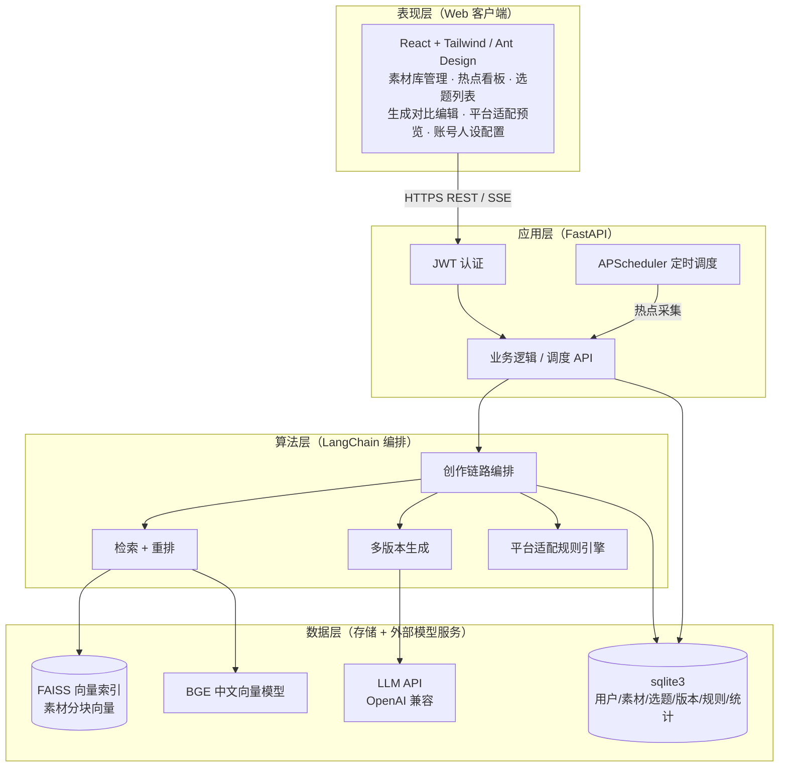
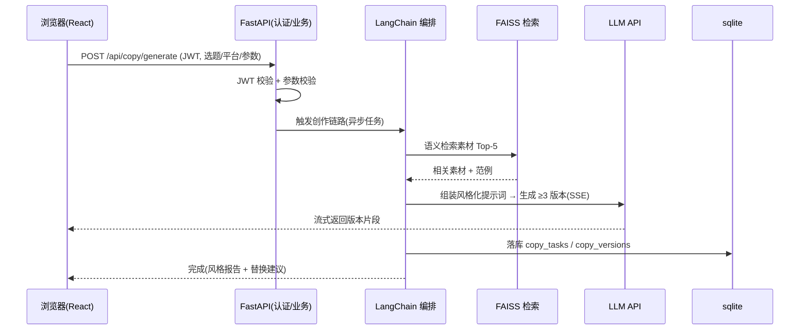
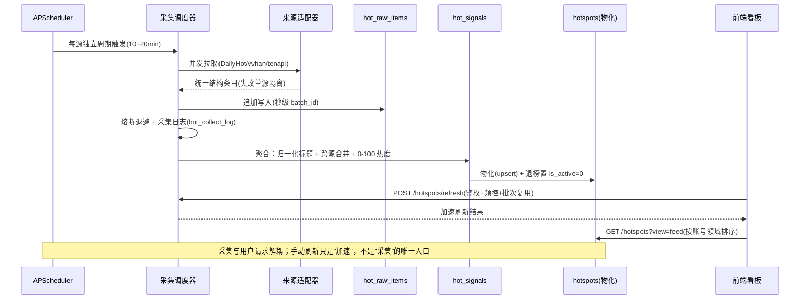
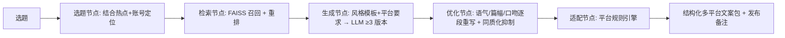

# AI 自媒体内容创作助手 — 系统架构设计

> 版本：V1.0.1 ｜ 对应项目计划书 V1.0.0 第三章 技术方案 + 第四章 4.1/4.3/4.5/4.6
> 交付物归属：M1 需求与方案设计 → T1.2 系统架构设计
> 修订：V1.0.1（评审修订 — 数据层明确标注含外部模型服务；补充外部依赖归类说明）

## 1. 架构总览（B/S 分层）

采用前后端分离的 B/S 架构，整体分为四层：

## 2. 请求流（同步创作请求）

## 3. 热点采集流（分源调度 + 三层模型 + 手动加速）

三层模型的职责分离（详见 `docs/热点采集方案设计V2.md`）：
- `hot_raw_items`：追加式原始层，跨平台同名**各自保留**，用于算首次上榜时间与覆盖度
- `hot_signals`：聚合层，跨源同话题**有意合并**，热度归一化到 0-100，承载生命周期
- `hotspots`：物化宽表，供 F2 选题按 `domain` 读取；保留该表是为了不破 `topics.hotspot_id` 外键

## 4. RAG 文案生成链路（核心）

## 5. 分层职责说明

| 层 | 职责 | 关键技术 |
|---|---|---|
| 表现层 | 素材管理、热点看板、选题、生成对比、适配预览、账号人设配置；响应式 | React + Tailwind/AntD |
| 应用层 | JWT 认证、业务 API、APScheduler 调度 | FastAPI |
| 算法层 | 链路编排、检索重排、多版本生成、风格/平台适配 | LangChain |
| 数据层 | 业务库 + 向量索引 + 外部模型 | sqlite3 + FAISS + LLM/BGE |

## 6. 关键设计点
- **前后端解耦**：热点采集由 APScheduler 按「每源独立节奏」触发，与用户请求分离；手动刷新端点仅用于加速，不承担采集主路径（计划书 3.1）
- **流式不阻塞**：长任务 SSE 流式输出，重任务后台调度（计划书 2.2.2）
- **向量主存储**：FAISS 承载分块向量，sqlite 存文本/元数据（计划书 4.5）
- **配置外置**：模型地址/采集源/平台规则可运维调整（计划书 2.2.5）
- **安全**：HTTPS + 字段加密 + 脱敏 + API Key 不入库（计划书 2.2.4）
- **外部依赖归类**：LLM API 与 BGE 为外部算法服务，置于「数据层」仅表示被算法层调用；二者为第三方/本地模型服务，非本系统存储，部署时需保证国内网络直连或镜像可用（计划书 2.3）

## 7. 与数据库设计衔接
- 业务表（users/materials/material_chunks/hotspots/topics/copy_tasks/copy_versions/platform_rules/stats）见 `db/数据库设计.md` 与 `db/schema.sql`
- 向量索引（material_chunks 的 embedding）与 FAISS 文件通过 `chunk_id` 对齐
