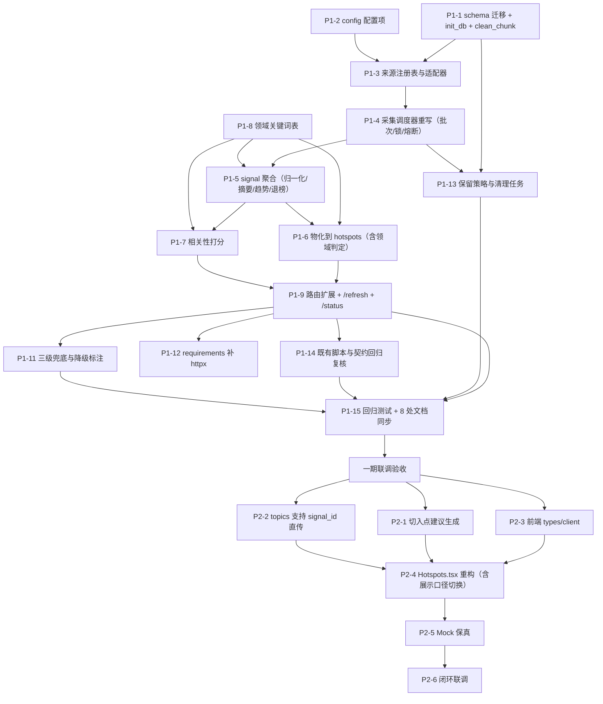

# 热点采集开发任务清单 V2.1

> 依据：`docs/热点采集方案设计V2.md`（V2.0.0）
> 版本：**V2.6.0** ｜ 日期：2026-10-26 ｜ 状态：**一期 + 二期 + P2-7 采纳埋点均已实施并通过验收**（详见 §12 一期、§13 真实网络验证、§14 二期、§15 埋点）
> 范围：一期（P1，解决"数据是假的"）+ 二期（P2，解决"用户嫌麻烦"）
> 说明：任务卡按可独立提交的粒度拆分，每张卡自带验收口径；禁止合并提交导致无法二分定位回归。

## 修订记录

| 版本 | 日期 | 变更 |
|---|---|---|
| V2.6.0 | 2026-10-26 | **P2-7 采纳埋点**：新增 `hot_feed_event`（14 表 / 20 索引）与 `POST /hotspots/events`；曝光（前端渲染后上报）/采纳（点击）/出题（服务端写）三级漏斗，`/status` 输出 `ctr` 与 `adopt_to_generate`；顺带产出「已用过」标记。修掉二期遗留的 React 严格模式双发出题（一次点击烧两次 LLM）。见 §15 |
| V2.5.0 | 2026-10-26 | **二期实施完成**（P2-1 ~ P2-6）：① 新增 `api/core/hot_suggestion.py`（建议角度：惰性 + 批量 + 确定性兜底）；② `/topics/generate` 支持 `signal_id` 热点直传并落地 `topics.hotspot_id`；③ `Hotspots.tsx` 重构为「懒人候选池」三视图（推荐/全部/按来源）；④ Mock 保真；⑤ 闭环联调取证。记录 7 处实施期偏差与 3 项真实数据发现（§14） |
| V2.4.0 | 2026-10-22 | **真实网络验证 + 三处修正**：① 新增 `official` 适配器层，直连 5 个平台官方接口（百度/B站/抖音/头条/微博），实测 5 源 100 条 / 1.9s / 无降级；② 修复 `hot_collect_log.created_at` 用 UTC 默认值导致频控失效（§12.3 偏差 #7）；③ 领域词表按真实漏判样本扩充，命中率 13.3% → 25.7%；④ 推荐流默认剔除「综合」并新增 `include_misc` 参数（§13） |
| V2.3.0 | 2026-10-22 | **一期实施完成**（P1-1 ~ P1-15），T-01 ~ T-18 全通过；记录 6 处实施期偏差与修复（§12.3）。二期 P2 未实施 |
| V2.2.0 | 2026-10-14 | 自审修复 10 项：① 估点合计算错（一期 8.5→11.5、总计 12.3→15.3）并补入测试/文档/清理/资产同步工时；② 新增 P1-13 保留策略与清理任务（原方案 raw 层无清理，半年约 155 万行）；③ 新增 P1-14 既有脚本与前端契约回归复核（原漏 `api/_demo.py`、`api/_e2e_test.py`）；④ 新增 P1-15 回归测试与 8 处文档同步工时；⑤ 补 `summary` 字段的数据来源（原 `hotspots.summary` 无写入路径，而前端卡片依赖它）；⑥ 补 `trend` 的计算规则与上轮值字段（原文只在 DDL 里出现，无任何任务计算它）；⑦ 消除 `heat` 展示口径自相矛盾（明确一期保留字段、二期切展示）；⑧ 明确旧配置键 `HOTSPOT_ENABLED`/`HOTSPOT_INTERVAL_MINUTES` 的处置（原会造成两套开关并存）；⑨ 消除 `domain_hint` 职责边界矛盾（原同时归适配器与领域词表）；⑩ 补批次幂等与并发（batch_id 改秒级 + 全局采集锁 + 批次复用）。 |

---

## 0. 前置决策（三条，已定，不再讨论）

| 决策 | 内容 | 理由（基于现有代码实测） |
|---|---|---|
| **D1** | **保留 `hotspots` 表，不删**。它降级为"物化宽表"（决策层的输出），由 `hot_signals` 物化而来 | ① `db/schema.sql:99` 有 `topics.hotspot_id → hotspots(id)` 外键，删表会破 FK；② `topics.py:24-29` 直接读 `hotspots` 并按 `domain` 过滤，保留表 = F2 **零改动**；③ `clean_chunk.py` 会播种该表；④ 可回滚——新链路出问题只需停调度，旧表结构仍在 |
| **D2** | **数据库走 `clean_chunk.py --reset` 重建**，不写 ALTER 迁移脚本 | 现库已是干净态（仅 10 条种子热点、无历史包袱）；本次为破坏性重构，写兼容迁移的收益低于维护成本 |
| **D3** | **采集写库端点必须鉴权 + 最小间隔** | `api/routers/hotspots.py` 当前**完全没有** `Depends(get_current_user)`（对比 `materials.py`/`topics.py` 都有）；新增"写库 + 对外发请求"端点不能裸奔 |

**唯一前置阻塞项：数据源。** 建议一期先用现成免费 JSON 源（vvhan / tenapi 等）跑通多适配器，**不要**把"自托管 DailyHot 实例"作为一期阻塞项——否则整个改造的关键路径压在一次外部部署上。

---

## 1. 任务依赖图



> 说明：**P1-1 与 P1-2 互不依赖，可并行**（配置项只是新增环境变量，不依赖 schema 落地）。原稿把二者串行是虚假依赖。

---

## 2. 数据表 DDL（可直接执行）

### 2.1 新增表

```sql
-- -------------------------------------------------------------
-- hot_raw_items — 原始采集层（追加式，永不更新，保留时间序列）
--   存在的意义：只有保留"每轮抓到了什么"，才能算出
--   ① 首次上榜时间（新颖度）② 是否持续在榜（趋势）③ 跨源覆盖度
-- -------------------------------------------------------------
CREATE TABLE hot_raw_items (
    id           INTEGER PRIMARY KEY AUTOINCREMENT,
    source_code  TEXT    NOT NULL,                 -- weibo/zhihu/baidu/douyin/bilibili/toutiao
    title        TEXT    NOT NULL,                 -- 原样标题，不做归一化
    summary      TEXT,                             -- 源提供的摘要/描述，可为空（部分源不提供）
    url          TEXT,
    rank         INTEGER,                          -- 榜单内排名（1-based）
    raw_heat     INTEGER,                          -- 原始热度，仅同源内可比，禁止跨源排序
    batch_id     TEXT    NOT NULL,                 -- 采集批次，秒级，如 20261014T165003
    fetched_at   TEXT    NOT NULL,                 -- 'YYYY-MM-DD HH:MM:SS'
    UNIQUE (source_code, title, batch_id)          -- 同批次同源同标题只留一条
);
CREATE INDEX idx_hot_raw_lookup ON hot_raw_items(source_code, title, fetched_at);
CREATE INDEX idx_hot_raw_batch  ON hot_raw_items(batch_id);

-- -------------------------------------------------------------
-- hot_signals — 聚合层（跨源合并 + 热度归一化 + 生命周期）
-- -------------------------------------------------------------
CREATE TABLE hot_signals (
    id              INTEGER PRIMARY KEY AUTOINCREMENT,
    canonical_key   TEXT    NOT NULL UNIQUE,       -- sha256(归一化标题)
    canonical_title TEXT    NOT NULL,              -- 展示标题：取覆盖源中 rank 最优的原题
    summary         TEXT,                          -- 取覆盖源中首条非空摘要；全空则用「{来源名}热榜话题」
    source_count    INTEGER NOT NULL DEFAULT 0,    -- 本轮覆盖的来源数（趋势强度）
    sources         TEXT,                          -- 逗号分隔来源码
    best_rank       INTEGER,                       -- 跨源最优排名（仅参考，不参与排序主键）
    prev_best_rank  INTEGER,                       -- 上轮最优排名（算 trend 用，每轮滚动）
    norm_heat       REAL    NOT NULL DEFAULT 0,    -- 0-100 归一化热度
    prev_norm_heat  REAL,                          -- 上轮归一化热度（算 trend 用）
    trend           TEXT,                          -- 上升/平稳/下降（推导规则见 P1-5）
    main_domain     TEXT,                          -- 主领域：命中的最高分领域；未命中为「综合」
    first_seen_at   TEXT    NOT NULL,              -- 首次上榜
    last_seen_at    TEXT    NOT NULL,              -- 最近在榜（退榜判据）
    source_url      TEXT,                          -- 代表链接
    suggestion      TEXT,                          -- 切入建议（惰性生成，可空）
    suggestion_at   TEXT,
    created_at      TEXT    NOT NULL DEFAULT (datetime('now'))
);
CREATE INDEX idx_hot_signals_last_seen ON hot_signals(last_seen_at);
CREATE INDEX idx_hot_signals_heat      ON hot_signals(norm_heat);
CREATE INDEX idx_hot_signals_domain    ON hot_signals(main_domain, last_seen_at);

-- -------------------------------------------------------------
-- hot_source_state — 来源健康状态（熔断退避依据）
-- -------------------------------------------------------------
CREATE TABLE hot_source_state (
    source_code   TEXT PRIMARY KEY,
    last_ok_at    TEXT,
    last_error    TEXT,
    fail_streak   INTEGER NOT NULL DEFAULT 0,
    backoff_until TEXT,                            -- 该时刻前不再请求该源
    total_fetched INTEGER NOT NULL DEFAULT 0
);

-- -------------------------------------------------------------
-- hot_collect_log — 采集日志（成功率 / P95 耗时的唯一数据来源）
--   没有这张表，"采集成功率 ≥95%""P95 ≤5s"就是空口指标
-- -------------------------------------------------------------
CREATE TABLE hot_collect_log (
    id          INTEGER PRIMARY KEY AUTOINCREMENT,
    batch_id    TEXT    NOT NULL,
    source_code TEXT    NOT NULL,
    ok          INTEGER NOT NULL,                  -- 1 成功 / 0 失败
    item_count  INTEGER DEFAULT 0,
    elapsed_ms  INTEGER,
    error       TEXT,
    created_at  TEXT    NOT NULL DEFAULT (datetime('now'))
);
CREATE INDEX idx_hot_collect_log_batch ON hot_collect_log(batch_id, source_code);
```

### 2.2 `hotspots` 表改造（替换现有定义）

```sql
CREATE TABLE hotspots (
    id            INTEGER PRIMARY KEY AUTOINCREMENT,
    signal_id     INTEGER,                       -- 物化来源（可空：种子数据无 signal）
    title         TEXT    NOT NULL,
    summary       TEXT,
    source        TEXT,                          -- 展示用来源名，如「微博热搜」
    platform      TEXT,                          -- 来源码 weibo/zhihu/...（★非发布平台码）
    url           TEXT,
    domain        TEXT,                          -- ★主领域，由 main_domain 写入；未命中为「综合」
    heat          INTEGER DEFAULT 0,             -- 原始热度，★一期仅为不破坏前端契约而保留，不参与排序
    norm_heat     REAL    DEFAULT 0,             -- 0-100 归一化热度（排序主用；展示口径切换见 P2-4）
    source_count  INTEGER DEFAULT 1,             -- 覆盖来源数
    trend         TEXT,
    first_seen_at TEXT,
    is_new        INTEGER DEFAULT 1,             -- 是否新上榜（默认视图用）
    suggestion    TEXT,                          -- 切入建议
    dedup_hash    TEXT,                          -- = hot_signals.canonical_key
    collected_at  TEXT    NOT NULL DEFAULT (datetime('now')),
    is_active     INTEGER NOT NULL DEFAULT 1,
    UNIQUE (dedup_hash),
    FOREIGN KEY (signal_id) REFERENCES hot_signals(id) ON DELETE SET NULL
);
CREATE INDEX idx_hotspots_domain      ON hotspots(domain, is_active);
CREATE INDEX idx_hotspots_platform    ON hotspots(platform, is_active);
CREATE INDEX idx_hotspots_active_heat ON hotspots(is_active, norm_heat);
```

> ⚠️ **命名铁律**：`hotspots.platform` 是**热榜来源码**（`weibo/zhihu/...`），与 `platform_rules.platform`（发布平台码 `weixin/xhs/douyin`）**语义完全不同**。前端 `types.ts` 已有的 `PLATFORMS` 常量**不得复用**，新增 `HOT_SOURCES`。这条不写进代码注释，半年后必被误用。

> ⚠️ **两层去重的语义差异（最易被误解的一处）**：
> - **raw 层**：跨平台同名话题**各自保留**（保真，用于统计覆盖度）。
> - **signal 层**：跨平台同一话题**有意合并为一条**（趋势识别的核心价值）。
> 这不是矛盾，是分工。禁止在 raw 层做跨源合并，也禁止在 signal 层保留同话题多行。

> ⚠️ **三个「前端在展示、但容易没有写入来源」的字段**（原稿的真实漏洞）：
> - `summary`：前端 `Hotspots.tsx:88` 用 `line-clamp-3` 展示它。写入路径必须在 P1-5 明确：raw 层存源提供的摘要（可为空）→ signal 层取"覆盖源中首条非空摘要"→ 全部为空时兜底生成 `「{来源名}热榜话题」`，**不允许为 NULL**。
> - `trend`：前端 `Hotspots.tsx:90` 展示"趋势：{trend}"。原稿只在 DDL 里出现该列、**没有任何任务计算它**。推导规则归 P1-5：比较本轮与上轮 `best_rank`／`norm_heat`（故需保留 `prev_best_rank`、`prev_norm_heat`），排名上升或热度上升 → 上升；反之 → 下降；变化在阈值内 → 平稳。
> - `heat`：前端 `Hotspots.tsx:84` 用火焰图标展示它。**一期保留该字段是为不破坏前端契约，不是"承诺继续用它展示"**——跨源原始热度不可比，展示口径的切换由 P2-4 负责（改用 `norm_heat`，原始热度降为"平台内第 N 名"）。若一期就改前端展示，则该改动必须并入 P1-14 的回归范围。

### 2.3 `init_db.py` / `clean_chunk.py` 同步

- `EXPECTED_TABLES` 由 9 张扩为 **13 张**（+4）。
- `verify()` 的"去重约束实测"改为对 `hot_raw_items` 的 `(source_code,title,batch_id)` 做断言；新增一条 `hot_signals.canonical_key` 唯一约束断言。
- `verify()` 索引数断言由 `>= 9` 改为 **`>= 18`**（现有 10 个 `idx_`，本次净增 8 个：新表 6 个 + `hotspots` 新增 2 个，`idx_hotspots_domain` 为同名替换不计入）。
- `clean_chunk.py` 的 `HOTSPOT_SEEDS` 播种路径改为：写 `hot_raw_items`（1 个批次）→ 跑一次 signal 聚合 → 物化 `hotspots`。**不要**保留"直接 INSERT hotspots"的老路径，否则种子数据没有 `signal_id`、`first_seen_at`，默认视图行为不一致。

---

## 3. 配置项（`api/config.py` 新增，`frontend/.env.example` 同步）

```python
# -------- 热点采集 V2（来源 / 调度 / 排序） --------
HOT_SOURCES_ENABLED = os.environ.get("HOT_SOURCES_ENABLED", "weibo,zhihu,baidu,douyin,bilibili,toutiao").split(",")
HOTSPOT_API_BASE        = os.environ.get("HOTSPOT_API_BASE", "")   # 自托管 DailyHot 实例；空则用内置免费源适配器
HOTSPOT_TIMEOUT         = int(os.environ.get("HOTSPOT_TIMEOUT", "8"))          # 单源超时(s)
HOTSPOT_SCHED_ENABLED   = os.environ.get("HOTSPOT_SCHED_ENABLED", "true").lower() == "true"
HOTSPOT_MIN_REFRESH_INTERVAL = int(os.environ.get("HOTSPOT_MIN_REFRESH_INTERVAL", "60"))   # 手动刷新最小间隔(s)
HOTSPOT_SIGNAL_TTL_HOURS     = int(os.environ.get("HOTSPOT_SIGNAL_TTL_HOURS", "24"))       # 退榜阈值(h)
HOTSPOT_NEW_WINDOW_HOURS     = int(os.environ.get("HOTSPOT_NEW_WINDOW_HOURS", "24"))       # 新颖度窗口(h)
HOTSPOT_SUGGESTION_ENABLED   = os.environ.get("HOTSPOT_SUGGESTION_ENABLED", "true").lower() == "true"
HOTSPOT_MAX_SOURCES_PER_REFRESH = int(os.environ.get("HOTSPOT_MAX_SOURCES_PER_REFRESH", "6"))
HOTSPOT_RAW_RETENTION_DAYS = int(os.environ.get("HOTSPOT_RAW_RETENTION_DAYS", "7"))    # raw 层保留天数
HOTSPOT_LOG_RETENTION_DAYS = int(os.environ.get("HOTSPOT_LOG_RETENTION_DAYS", "30"))   # 采集日志保留天数
# 相关性权重：领域命中 / 新颖度 / 覆盖度 / 归一化热度 / 可创作性（和须为 1.0，启动时校验）
HOTSPOT_FEED_WEIGHTS = os.environ.get("HOTSPOT_FEED_WEIGHTS", "0.30,0.25,0.20,0.15,0.10")
```

### 3.1 旧配置键的处置（必须显式声明，否则两套开关并存）

`api/config.py` 现有两个热点键，本次改造后语义会重叠：

| 旧键 | 处置 | 理由 |
|---|---|---|
| `HOTSPOT_ENABLED`（默认 true） | **重命名为 `HOTSPOT_SCHED_ENABLED`**，不保留旧名 | 与新增键语义完全重叠。保留旧名会导致"关了一个开关调度还在跑"的排查地狱。改名的引用点：`api/main.py:13,32` |
| `HOTSPOT_INTERVAL_MINUTES`（默认 60） | **废弃删除** | 单一全局间隔被"每源独立节奏"取代（间隔移入 `SOURCES` 注册表）。保留会造成"改了环境变量却不生效"的静默失效 |

> 这两个键目前还出现在 `docs/M3交付说明与API文档.md:295` 的配置表里，属 §8 文档同步范围。

> 每源的采集间隔**不放在 config**，放在来源注册表里（见 P1-3）——因为它和适配器、权重是一组内聚信息，放在一起才不会出现"改了间隔忘了改适配器"。

---

## 4. 接口契约

### 4.1 `GET /api/hotspots`（扩展现有，保持向后兼容）

| 参数 | 类型 | 默认 | 说明 |
|---|---|---|---|
| `view` | `feed` \| `all` | `feed` | `feed`=按账号领域相关性排序（默认）；`all`=按 norm_heat 排序 |
| `domain` | str | — | 主领域过滤（保留既有语义；传 `综合` 可看未命中领域的条目） |
| `platform` | str | — | 来源码过滤（`weibo` 等） |
| `new_only` | bool | false | 只看新上榜 |
| `limit` | int | 20 | 上限 100 |

```json
{
  "ok": true,
  "count": 12,
  "view": "feed",
  "freshness": {
    "updated_at": "2026-10-14 16:50:00",
    "age_minutes": 3,
    "degraded": false,
    "sources_ok": 6,
    "sources_total": 6
  },
  "hotspots": [
    {
      "id": 1, "signal_id": 11,
      "title": "端侧大模型本地运行成为新热点",
      "summary": "…", "source": "微博热搜", "platform": "weibo",
      "url": "https://…", "domain": "科技",
      "heat": 98210, "norm_heat": 86.4, "source_count": 5,
      "trend": "上升", "first_seen_at": "2026-10-14 14:12:00", "is_new": 1,
      "suggestion": "建议角度：反着写「为什么我不建议现在买 AI 手机」…",
      "relevance": 82.5,
      "reason": "命中科技 · 5 个平台在讨论 · 2 小时前首次出现",
      "collected_at": "2026-10-14 16:50:00"
    }
  ]
}
```

> `relevance` 与 `reason` **仅在 `view=feed` 时返回**；`view=all` 不返回，避免用户误以为全榜也做了个性化。

### 4.2 `POST /api/hotspots/refresh`

**需鉴权**（`Depends(get_current_user)`）。语义是"加速刷新"，不是"采集"。

请求：`{"sources": ["weibo","zhihu"], "force": false}`
- `sources` 省略 = 用 `HOT_SOURCES_ENABLED`；数量超过 `HOTSPOT_MAX_SOURCES_PER_REFRESH` → **400**。
- 距上次成功采集 < `HOTSPOT_MIN_REFRESH_INTERVAL` 且 `force=false` → **429**，body 带 `retry_after_seconds`。判定基准是**任意来源的上次采集时间（含自动调度触发）**，不能只算手动触发——否则用户手动点一下会把自动调度的成果判为"太频繁"。
- **幂等**：若已有批次正在运行，**不新开批次**，直接复用并返回 `reused: true`（依据 P1-4 的全局采集锁）。避免并发请求对同一 signal 竞态写 `first_seen_at`、把新颖度算成更晚的时间。

响应 200：
```json
{"ok": true, "batch_id": "20261014T165003", "reused": false, "collected": 37,
 "by_source": {"weibo": 10, "zhihu": 10}, "failed": [],
 "degraded": false, "elapsed_ms": 1834}
```

### 4.3 `GET /api/hotspots/status`

**需鉴权**（返回内部健康信息，含失败原因，不应公开）。

返回整体新鲜度 + 每源健康状态（`last_ok_at` / `fail_streak` / `backoff_until`）+ **由 `hot_collect_log` 聚合出的近 7 天 `success_rate` 与 `p95_elapsed_ms`**——否则 §7 的 T-14「指标可取」没有接口层验收入口，指标只能靠人工连库查。

### 4.4 `POST /api/topics/generate`（扩展）

请求体新增可选 `signal_id: int`。传入时以该信号的热点上下文作为选题主输入（**闭环的关键**：用户在看板上点"用它做选题"，不需要重述背景）。

---

## 5. 一期任务卡（P1）

### P1-1 schema 迁移 + 初始化脚本同步
- **目标**：4 张新表 + `hotspots` 改造 + 索引 + 初始化脚本与种子路径同步。
- **涉及**：`db/schema.sql`、`db/init_db.py`、`data/clean_chunk.py`
- **关键实现**：按 §2 执行；`EXPECTED_TABLES` 扩为 13；种子改走 raw→signal→物化。
- **验收**：`python db/init_db.py --check` 通过；`python data/clean_chunk.py --reset` 后 13 张表齐全、`hot_signals` 与 `hotspots` 均有数据且 `signal_id` 非空、无孤儿行。
- **依赖**：无 ｜ **估点**：0.5 人日

### P1-2 配置项
- **涉及**：`api/config.py`、`frontend/.env.example`
- **关键实现**：按 §3；启动时校验 `HOTSPOT_FEED_WEIGHTS` 长度=5 且和为 1.0（不合法则回落默认并打印告警，**不得抛异常导致服务起不来**）。
- **验收**：改 `.env` 即生效；非法权重有告警且服务正常运行。
- **依赖**：P1-1 ｜ **估点**：0.2 人日

### P1-3 来源注册表与适配器（`api/core/hot_sources.py`）
- **目标**：可插拔的来源适配层，统一输出归一化条目。
- **关键实现**：
  - `SOURCES = {"weibo": {"name":"微博热搜","adapter":"dailyhot","route":"weibo","interval_min":10,"weight":1.0}, ...}`
  - 三类适配器：`dailyhot`（自托管实例）、`vvhan`、`tenapi`（免费 JSON）；各适配器只负责"取原始 JSON → 统一结构"。
  - 统一结构：`{source_code, title, summary, url, rank, raw_heat}`（`summary` 允许为空字符串）。
  - ⚠️ **适配器不做领域判定**：输出里**没有** `domain_hint`。领域判定统一由 P1-5 在聚合阶段调用 P1-8 的关键词表完成。适配器的唯一职责是"把异构 JSON 变成同构 JSON"。
  - **单源超时与异常必须隔离**，返回 `(items, error)`，绝不上抛。
- **验收**：对每个启用源单独调用均返回 `(items, None)` 或 `( [], "原因")`；**任一源失败不影响其他源**；`title` 为空/NULL 的条目被丢弃；适配器返回对象内**不出现**领域相关字段。
- **依赖**：P1-1、P1-2 ｜ **估点**：1.5 人日

### P1-4 采集调度器重写（`api/core/hot_collector.py`）
- **目标**：分源独立节奏 + 熔断退避 + 批次记录 + 日志落库。
- **关键实现**：
  - 每源一个 APScheduler job，`interval` 取注册表的 `interval_min`。
  - **`batch_id` 用秒级时间戳**（`%Y%m%dT%H%M%S`），不用分钟级——分钟级会让同一分钟内的两次采集共用一个 `batch_id`，从而被 `(source_code,title,batch_id)` 唯一约束**静默吞掉后一次的数据**。
  - **全局采集锁**：进程内 `threading.Lock` 保证同一时刻只有一个批次在跑；已有批次运行时，新请求复用该批次（配合 §4.2 的 `reused`）。
  - 写 `hot_raw_items`（带 `batch_id`）、写 `hot_collect_log`、更新 `hot_source_state`。
  - 熔断：`fail_streak >= 3` → 指数退避写 `backoff_until`，退避期内跳过该源。
  - 保留 `seed_if_empty()` 作为最后一级兜底（改为写 raw 层）。
- **验收**：启动日志能看到每个源的独立周期；连续断网后 `hot_source_state.fail_streak` 递增且进入退避；恢复后自动跑通；`hot_collect_log` 有完整记录；**并发发起两次刷新，第二次返回 `reused: true` 且 `hot_raw_items` 不产生重复批次**；同一分钟内两次采集的 `batch_id` 不相等。
- **依赖**：P1-3 ｜ **估点**：1.5 人日

### P1-5 signal 聚合（`api/core/hot_signal.py`）
- **目标**：raw → signal，解决热度不可比、跨源重复、退榜三件事。
- **关键实现**：
  - `canonical_key(title)`：去 `#` 话题符 → 去 emoji → 全角转半角 → 去空白与标点 → `sha256`。
  - 本轮 raw 条目按 `canonical_key` 分组；`source_count` = 分组内不同 `source_code` 数；`sources` 逗号拼接。
  - `canonical_title` 取**覆盖源中 rank 最优**的那条原题（不是"首次出现的"——首次出现的可能恰好是带 `#` 或截断最脏的一条）。
  - `summary` 取分组内**首条非空**摘要，全空时兜底 `「{来源名}热榜话题」`（**不允许为 NULL**，前端 `line-clamp-3` 依赖它）。
  - `norm_heat` 归一化：**先在同源内按 rank 线性映射到 0-100，再按 `source_count` 加权**（多源同时出现 = 真趋势）。
  - `trend` 推导：每轮更新前把当前 `best_rank`/`norm_heat` 滚入 `prev_*`，再比较——排名或热度上升 → `上升`；下降 → `下降`；变化在阈值内 → `平稳`。首轮无上轮值 → `平稳`。
  - **领域判定**：调 P1-8 的 `domain_keywords` 给分组打 `main_domain`（命中最高分领域，未命中 → `综合`）。
  - `first_seen_at` 只在新 key 插入时写；`last_seen_at` 每轮更新。
  - 退榜：`last_seen_at < now - TTL` 的 signal 不进入 feed/物化，**raw 数据保留**（保留时长由 P1-13 的清理任务管）。
- **验收**：同一话题在不同平台的两种写法（带/不带 `#`、全半角差异）合并为 1 条且 `source_count>=2`；单源孤例 `source_count=1`；**`summary` 在源无摘要时也不为 NULL**；**连续两轮采集后 `trend` 随排名变化正确取到 `上升`/`下降`**；`main_domain` 对科技类标题判为 `科技`、对无关标题判为 `综合`；构造一条 `last_seen_at` 超 TTL 的 signal，确认不出现在 feed 与物化结果中，但 raw 行仍在。
- **依赖**：P1-4、**P1-8** ｜ **估点**：1.5 人日

### P1-6 物化到 hotspots + 领域判定（★ 修 F2 领域塌陷）
- **目标**：signal → `hotspots`，并把 `domain` 写对。
- **关键实现**：
  - 每轮 signal 刷新后 upsert `hotspots`（`ON CONFLICT(dedup_hash) DO UPDATE`），`dedup_hash = canonical_key`。
  - `domain = main_domain`（命中领域关键词表的最高分领域）；**未命中写「综合」**，而不是全部写「综合」。
  - 「综合」条目**不出现在 5 个官方领域的筛选结果里**，只在 `view=feed`/`all` 与显式 `domain=综合` 时出现——这样 F2 按领域取热点时不会混入无关内容。
  - `is_active` 与 signal 的生命周期联动（退榜置 0）。
- **验收**：构造科技类热点，确认 `domain='科技'`、且 F2 选「科技」能取到它；构造无关热点，确认 `domain='综合'` 且 F2 选「科技」取不到；重复采集同批次行数不增长但 `norm_heat/collected_at` 更新（upsert 生效）。
- **依赖**：P1-5、P1-8 ｜ **估点**：1 人日

### P1-7 相关性打分（`api/core/hot_rank.py`）
- **目标**：`view=feed` 的排序与可解释理由。
- **关键实现**：
  - 5 因子按 §3 权重加权；输入为 signal 字段 + 当前用户 `users.domains` / `positioning`。
  - `reason` 生成：`命中{domain} · {source_count} 个平台在讨论 · {X} 小时前首次出现`。
  - 无 persona（未配置领域）时 **退化为 norm_heat 排序**，不报错。
- **验收**：为同一批数据构造两个不同 `domains` 的账号，确认 feed 排序不同；`reason` 与字段自洽；未配置人设的账号不报错。
- **依赖**：P1-6、P1-8 ｜ **估点**：1 人日

### P1-8 领域关键词表（`api/core/domain_keywords.py`）
- **目标**：领域命中判定的唯一数据源。
- **关键实现**：覆盖全部 **5** 个领域（科技/生活/财经/美妆/教育）。
  - ⚠️ 注意 `api/core/llm.py` 的 `DOMAIN_KW` **只有 3 个领域**（缺美妆/教育），本模块须补齐；并让 `llm.py` 改为从本模块导入，消除两处词表不一致。
  - 命中算法：标题分词后与词表做包含匹配，`score = 命中词数 × 词权重`。
- **验收**：5 个领域各构造 3 条样例标题，命中正确；与 `DOMAINS`（`frontend/src/api/types.ts`）领域集合完全一致。
- **依赖**：无 ｜ **估点**：0.5 人日

### P1-9 路由扩展（`api/routers/hotspots.py`）
- **目标**：§4.1–4.3 三个端点。
- **关键实现**：`GET` 加 `view/domain/platform/new_only`；新增 `POST /refresh`（**挂 `Depends(get_current_user)`** + 最小间隔 + 来源数上限 + 批次复用）、`GET /status`（**同样挂鉴权**，返回近 7 天成功率与 P95）。
- **验收**：见 §7 测试用例 T-06 ~ T-10、T-15 ~ T-18；无 token 调 `/refresh` 与 `/status` 均返回 **401**。
- **依赖**：P1-6、P1-7 ｜ **估点**：1 人日

### P1-10 main.py 调度接入
- **涉及**：`api/main.py`
- **关键实现**：`HOTSPOT_SCHED_ENABLED`（**由 `HOTSPOT_ENABLED` 重命名**，见 §3.1）控制调度常驻，需同步改 `api/main.py:13,32` 两处引用；lifespan 关闭时 `shutdown_scheduler()` 保持；**`/api/health` 的 counts 列表加入 4 张新表**（否则 health 看不到新数据）。
- **验收**：`/api/health` 返回 13 张表计数；关闭调度开关后无 job 启动日志；**全库 grep 确认不再有 `HOTSPOT_ENABLED` / `HOTSPOT_INTERVAL_MINUTES` 的有效引用**。
- **依赖**：P1-4 ｜ **估点**：0.2 人日

### P1-11 三级兜底与降级标注
- **关键实现**：
  - ① 实时源 → ② **DB 已有数据**（`hot_signals`/`hotspots` 本身即持久缓存，**无需新增缓存层**）→ ③ 内置种子。
  - `freshness.degraded=true` 且前端必须显式提示"数据为 X 小时前"。
- **验收**：全源不可达时看板**仍有数据**且 `degraded=true`；恢复后自动转正常。**空屏率 = 0。**
- **依赖**：P1-9 ｜ **估点**：0.5 人日

### P1-12 依赖补齐
- **涉及**：`api/requirements.txt`
- **关键实现**：补 `httpx`（当前**未在依赖清单中**，但适配器需要它；沙箱 venv 已装 0.28.1，生产环境会缺）。
- **验收**：全新 venv 按 requirements 安装后可启动并完成一次采集。
- **估点**：0.1 人日

### P1-13 保留策略与清理任务（原稿缺失）
- **目标**：防止追加式 raw 层与采集日志无限膨胀。
- **量化依据**：6 源 × 10 条 = 60 条/轮；按平均 30 分钟/轮 → **约 2,880 行/天、52 万行/半年**；`hot_collect_log` 另有约 864 行/天。
- **涉及**：`api/core/hot_collector.py`（新增每日清理 job）、`api/config.py`（`HOTSPOT_RAW_RETENTION_DAYS`、`HOTSPOT_LOG_RETENTION_DAYS`）
- **关键实现**：APScheduler 每日 1 次，删除 `hot_raw_items.fetched_at < now - RAW_RETENTION_DAYS` 与 `hot_collect_log.created_at < now - LOG_RETENTION_DAYS`；**只清 raw 与日志，不动 `hot_signals`/`hotspots`**（后者由 TTL 退榜机制处理）；清理日志打印删除行数。
- **验收**：手工把 `RAW_RETENTION_DAYS` 设为 0 跑一次清理，确认 raw 被清空而 signal/hotspots 不受影响；正常运行 7 天后 raw 行数稳定在"7 天 × 日均量"而非持续增长。
- **依赖**：P1-1、P1-4 ｜ **估点**：0.5 人日

### P1-14 既有脚本与前端契约回归复核（原稿缺失）
- **目标**：改造不打破既有调用方。原稿完全没提这两个脚本。
- **涉及**：`api/_demo.py`（第 52-55 行读 `/api/hotspots`）、`api/_e2e_test.py`（第 32 行读 `/api/hotspots`）、`frontend/src/pages/Hotspots.tsx`（第 21 行请求参数）
- **关键实现**：
  - 三个调用方读取的字段是 `title/summary/source/url/domain/heat/trend/collected_at`——**这些字段在新契约里全部保留**，属"形状兼容"。
  - 风险在**语义**：`GET /api/hotspots` 默认 `view` 改为 `feed`。若种子/演示数据没有 signal 聚合结果，或 demo 账号未配置领域，脚本可能取到空列表而断言失败。
  - `_demo.py` 的 banner 文案「热点列表」建议同步为「热点推荐流」。
- **验收**：`python api/_demo.py` 与 `python api/_e2e_test.py` 在改造后均跑通；`Hotspots.tsx` 不改代码也能正常渲染（仅排序变化）。
- **依赖**：P1-9 ｜ **估点**：0.5 人日

### P1-15 回归测试与文档同步（原稿缺失估点）
- **目标**：让 §7 的用例与 §8 的 8 处文档同步真正有人日归属（原稿把它们算作免费）。
- **涉及**：§7 全部用例（T-01 ~ T-18）、§8 的 8 份文档、`frontend/.env.example`
- **关键实现**：
  - 逐条跑 T-01 ~ T-18 并留执行记录（可复用项目现有的冒烟取证方式）。
  - §8 的 8 处文档逐处更新；其中 **PRD F1.4 属需求基线变更，必须单独写变更说明**，不能只在 PRD 里改一行验收标准。
  - 前端门禁：`tsc --noEmit` + `vite build`（若一期动了前端类型则必跑；未动也跑一次确认无连带影响）。
- **验收**：T-01 ~ T-18 全过且留痕；8 处文档 diff 可查；PRD 变更有独立说明段落。
- **依赖**：P1-11、P1-13、P1-14 ｜ **估点**：1 人日

---

## 6. 二期任务卡（P2）

### P2-1 切入点建议生成（`api/core/hot_suggestion.py`）
- **涉及**：`api/core/hot_suggestion.py`（新增）、`api/core/prompts.py`（加 `SYSTEM_HOT_ANGLE`）
- **关键实现**：复用 `get_llm()`；**惰性生成**（首次被 feed 返回时生成并回写 `suggestion`），避免每轮采集批量调 LLM 烧钱。
- **验收**：`HOTSPOT_SUGGESTION_ENABLED=false` 时字段为空且前端不显示该行；开启后每条建议 ≤40 字、含一个具体切入角度。
- **依赖**：P1-9 ｜ **估点**：0.5 人日

### P2-2 选题支持热点直传
- **涉及**：`api/routers/topics.py`、`api/core/rag_pipeline.py`、`api/core/prompts.py`
- **关键实现**：`GenerateReq` 加 `signal_id`；传入时取该 signal 的 `canonical_title` + `main_domain` 覆盖 `req.domain` 作为主输入。
- **验收**：携带 `signal_id` 生成的选题，其 `domain` 与该热点一致；不传时行为与现网一致（**向后兼容**）。
- **依赖**：P1-6 ｜ **估点**：0.5 人日

### P2-3 前端类型与常量
- **涉及**：`frontend/src/api/types.ts`
- **关键实现**：`Hotspot` 加 `signal_id/norm_heat/source_count/first_seen_at/is_new/suggestion/relevance/reason/platform`；新增 `HOT_SOURCES` 与 `hotSourceLabel()`；新增 `Freshness` 类型。
  - ⚠️ **不要动** `PLATFORMS`（发布平台码）。
- **验收**：`tsc --noEmit` 通过。
- **估点**：0.3 人日

### P2-4 热点看板重构（`frontend/src/pages/Hotspots.tsx`）
- **目标**：从"榜单 + 采集按钮"变成"懒人候选池"。
- **关键实现**：
  - 顶部：`N 分钟前更新 · X 个来源` + 低权重刷新图标（点击调 `/refresh`，429 时提示 `retry_after`）；`degraded` 时黄色提示条。
  - 默认视图「为你推荐」（`view=feed`），备选「全部」「按来源」。
  - 卡片：`新` 标记、`is_new` / `first_seen_at` 相对时间、`source_count` 个平台、主领域标签、**建议角度**一行、两个动作按钮`用它做选题` / `看原文 ↗`（`rel="noopener noreferrer"`）。
  - **去掉**平台多选与 top N（降级为"按来源"备选视图）。
- **验收**：首屏无"采集热点"按钮；空数据时展示兜底提示而非空白；`用它做选题` 能跳转选题页并带出上下文。
- **依赖**：P2-1、P2-3 ｜ **估点**：1.5 人日

### P2-5 Mock 保真（`frontend/src/api/mock.ts`）
- **关键实现**：`curatedHotspots`（第 131-157 行）补 `signal_id/first_seen_at/is_new/source_count/platform/suggestion`；`/hotspots?view=feed` 返回带 `freshness` 的结构；**Mock 数据必须标注"演示数据"**，不得伪装成真实采集结果。
- **验收**：Mock 模式下按来源/新标记/推荐视图筛选均不空白；页面显示演示标注。
- **估点**：0.5 人日

### P2-6 闭环联调
- **验收**：看板点"用它做选题" → 选题页出现 ≥3 条选题且领域正确 → 进入生成。（断点续生成不受影响）
- **估点**：0.5 人日

### P2-7（可选）每日热点日报
- **说明**：站内/邮件推送当日 top 3 推荐热点。**建议先不做**——在 Feed 采纳率建立基线之前做推送，等于放大一个未验证的信号。

---

## 7. 测试用例（一期验收）

| 编号 | 用例 | 期望 |
|---|---|---|
| T-01 | `canonical_key` 归一化 | 带 `#`、含 emoji、全角/半角、首尾空格的同一话题 → 同一 key |
| T-02 | 跨源合并 | 微博与知乎同一话题 → 1 条 signal，`source_count=2`，raw 层 2 行 |
| T-03 | 归一化边界（应合并 vs 不应合并） | 应合并：`#iPhone 17 发布#` / `iPhone17发布` / `ｉＰｈｏｎｅ 17 发布`（全角）→ 同 1 条；不应合并：`苹果发布新机` / `苹果价格上涨` → 2 条。**注：两条不同话题若归一化后完全相等，会被合并——这是本设计的明确取舍（保趋势识别，牺牲极端个例），需在测试注释中写明，避免被后人当 bug 改掉** |
| T-04 | 归一化热度 | 单源 10 条 rank 1..10 → `norm_heat` 单调递减且落在 0-100 |
| T-05 | 退榜 | 构造 `last_seen_at` 超 TTL → feed 与物化结果均不含，raw 行保留 |
| T-06 | 空屏兜底 | 断网/全源失败 → 返回非空 + `degraded=true` |
| T-07 | 鉴权 | 无 token `POST /refresh` → 401；无 token `GET /status` → 401 |
| T-08 | 频控 | 间隔内二次 `POST /refresh`（`force=false`）→ 429 + `retry_after_seconds` |
| T-09 | 来源数上限 | `sources` 超 `HOTSPOT_MAX_SOURCES_PER_REFRESH` → 400 |
| T-10 | 过滤 | `platform=weibo` 只返回微博源；`new_only=true` 只返回 `is_new=1` |
| T-11 | upsert | 同批次重复采集 → `hotspots` 行数不变，`norm_heat/collected_at` 更新 |
| T-12 | 领域判定 | 科技热点 `domain=科技` 且 F2 选科技可取到；无关热点 `domain=综合` 且 F2 取不到 |
| T-13 | F2 回归 | 不传 `signal_id` 调 `/topics/generate`，行为与改造前一致 |
| T-14 | 指标可取 | 由 `hot_collect_log` 能算出采集成功率与 P95，且 `/status` 能直接返回这两个值 |
| T-15 | 清理 | `RAW_RETENTION_DAYS=0` 跑一次清理 → raw 清空、`hot_signals`/`hotspots` 不受影响 |
| T-16 | 批次幂等与并发 | 并发两次 `POST /refresh` → 第二次 `reused=true`，不产生重复批次；同分钟内两次采集 `batch_id` 不相等 |
| T-17 | 摘要兜底 | 源的 `summary` 全为空 → `hotspots.summary` 仍非 NULL（兜底文案） |
| T-18 | 趋势推导 | 连续两轮采集，排名由第 5 升至第 2 → `trend=上升`；由第 2 降至第 8 → `trend=下降` |

---

## 8. 文档同步清单（漏一个就是文档与实现不一致）

| 文档 | 待改点 |
|---|---|
| `docs/PRD.md` | **F1.4 验收标准**：由「APScheduler 周期触发，dedup_hash 去重生效」改为「自动采集 + 个性化候选池 + 退榜机制」——**这是需求基线变更，需单独写变更说明** |
| `docs/架构设计.md` | §3「热点采集流」时序图重画（新增 signal 聚合与物化两步）；§102「热点采集由 APScheduler 周期触发，与用户请求解耦」需修正为「自动调度 + 手动加速刷新」 |
| `docs/M3交付说明与API文档.md` | 端点数（现 16 路由）→ 18；§5.2 热点接口表；**§295 配置表须删去 `HOTSPOT_ENABLED`/`HOTSPOT_INTERVAL_MINUTES`** 并补新键；§318「热点采集源为占位」需更新为「已接入真实源」 |
| `docs/项目说明.md` | §8 已知限制删去「热点采集为可配置占位源」；§7 关键约定补「热榜来源码 ≠ 发布平台码」 |
| `README.md` / `frontend/.env.example` | 新配置项与新端点 |
| `docs/产物审查报告.md` | 记一笔本次改造 |
| **代码资产（非文档，但必须同步）** | `api/_demo.py`、`api/_e2e_test.py` 的适配与复核见 P1-14；`api/config.py` 旧键删除见 §3.1 |

---

## 9. 风险与回滚

| 风险 | 缓解 | 回滚 |
|---|---|---|
| 免费源不稳定/失效 | 多适配器 + 熔断退避 + 三级兜底；端点地址外置 | 换适配器即可，不动上层 |
| 采集端点被滥用 | 鉴权 + 最小间隔 + 来源数上限 | — |
| 归一化误合并（把不同话题并成一条） | `canonical_key` 保留原始标题序列用于回溯；合并仅在标题归一化后**完全相等**时发生 | 收紧归一化规则（保留数字与专有名词） |
| 领域关键词表覆盖不全导致命中率低 | 词表外置、可人工维护；未命中落「综合」而非误判 | 调词表，无需改代码 |
| 破坏性重构影响 M5 已验收结论 | 四项量化指标（检索/适配/可用率/耗时）**不在本次改动路径上**，不受影响；F1.4 为新验收口径，需重跑对应验收 | 停调度 + `clean_chunk.py --reset` 回到改造前 schema |
| 项目已发布 GitHub | 改动走独立分支 → 验证通过再合入 `main`；`main` 保持可发布态 | 分支丢弃 |

---

## 10. 完成定义（DoD）

**一期 DoD**
1. `python db/init_db.py --check` 通过，13 张表齐全、`idx_` 索引 ≥18。
2. T-01 ~ T-18 全部通过，并有可查的执行记录。
3. 断网场景下看板**不空屏**且明确标注数据时间。
4. `hot_collect_log` 可算出成功率与 P95（且 `/status` 直接可得），两周真实运行后成功率 ≥95%、P95 ≤5s。
5. `hot_raw_items` 行数稳定在保留窗口内，**不单调增长**（P1-13 生效）。
6. `python api/_demo.py` 与 `python api/_e2e_test.py` 均跑通（P1-14）。
7. 8 处文档同步完成，**PRD F1.4 变更说明已独立成段**。
8. 全库 grep 确认无 `HOTSPOT_ENABLED` / `HOTSPOT_INTERVAL_MINUTES` 的有效引用残留。
9. `tsc --noEmit` + `vite build` 通过（前端门禁）。

**二期 DoD**
1. 首屏无"采集热点"按钮；默认视图为个性化推荐。
2. 每条热点有建议角度与"用它做选题"入口，闭环一次跑通。
3. Mock 模式标注演示数据，筛选不空白。
4. 建立 **Feed 采纳率** 基线（这是本功能唯一的北极星指标，一期/二期都不得用"采集成功率"替代它作为成功判据）。

---

## 11. 估点汇总

| 期 | 明细 | 人日 |
|---|---|---|
| 一期 | P1-1 0.5 / P1-2 0.2 / P1-3 1.5 / P1-4 1.5 / P1-5 1.5 / P1-6 1.0 / P1-7 1.0 / P1-8 0.5 / P1-9 1.0 / P1-10 0.2 / P1-11 0.5 / P1-12 0.1 / P1-13 0.5 / P1-14 0.5 / P1-15 1.0 | **11.5** |
| 二期 | P2-1 0.5 / P2-2 0.5 / P2-3 0.3 / P2-4 1.5 / P2-5 0.5 / P2-6 0.5（P2-7 可选不计） | **3.8** |
| **合计** | | **15.3** |

> ⚠️ **修正记录**：V2.1.0 曾写「一期 8.5 / 二期 3.8 / 合计 12.3」，其中一期明细实际加总为 9.5，属**算术错误**；且原稿未给测试（§7 的 18 条用例）与文档同步（§8 的 8 处）留任何工时——故新增 P1-13/14/15 后一期为 11.5，总计 15.3。

**最大不确定性**：P1-3 适配器（免费源结构差异与稳定性，±1 人日）、P1-5 聚合规则调优（归一化与合并边界，±1 人日）。**建议对外报 15.3 人日，按 17 人日排期**（含两次不测不出的返工余量）。


---

## 12. 实施记录（V2.3.0 · 2026-10-22）

### 12.1 一期完成情况

| 任务卡 | 状态 | 落地位置 |
|---|---|---|
| P1-1 schema + init_db + clean_chunk | ✅ | `db/schema.sql`（13 表 / 18 索引）、`db/init_db.py`、`data/clean_chunk.py` |
| P1-2 配置项 | ✅ | `api/config.py`、`.env.example`（新增）、`frontend/.env.example` |
| P1-3 来源注册表与适配器 | ✅ | `api/core/hot_sources.py`（dailyhot → vvhan → tenapi 三级适配器链） |
| P1-4 采集调度器重写 | ✅ | `api/core/hotspot_collector.py`（分源 job / 秒级批次 / 全局锁 / 熔断） |
| P1-5 signal 聚合 | ✅ | `api/core/hot_signal.py` |
| P1-6 物化 + 领域判定 | ✅ | `api/core/hot_signal.py::materialize` |
| P1-7 相关性打分 | ✅ | `api/core/hot_rank.py` |
| P1-8 领域关键词表 | ✅ | `api/core/domain_keywords.py`；`api/core/llm.py` 改为从此导入 |
| P1-9 路由扩展 | ✅ | `api/routers/hotspots.py`（GET 扩展 + `POST /refresh` + `GET /status`） |
| P1-10 main.py 调度接入 | ✅ | `api/main.py`（`HOTSPOT_SCHED_ENABLED` + health 12 表计数） |
| P1-11 三级兜底 | ✅ | `hotspot_collector.seed_if_empty` + 路由内兜底 + `freshness.degraded` |
| P1-12 依赖补齐 | ✅ | `api/requirements.txt` 补 `httpx` |
| P1-13 保留策略与清理 | ✅ | `hotspot_collector.cleanup_old_data` + 每日 04:10 job |
| P1-14 既有脚本回归 | ✅ | `api/_demo.py`、`api/_e2e_test.py` 未改代码通过 |
| P1-15 测试与文档同步 | ✅ | 本文档 §12.2、9 份文档已同步 |

### 12.2 验收结果（T-01 ~ T-18）

| 用例 | 结果 | 证据 |
|---|---|---|
| T-01 归一化 | ✅ | `#iPhone 17 发布#` / `iPhone17发布` / `ｉＰｈｏｎｅ 17 发布` / 带 emoji → 同一 `canonical_key` |
| T-02 跨源合并 | ✅ | 微博+知乎同话题 → `source_count=2`、`sources=weibo,zhihu`、raw 保留 2 行 |
| T-03 归一化边界 | ✅ | `苹果发布新机` / `苹果价格上涨` → 2 条独立 signal |
| T-04 归一化热度 | ✅ | rank 1..10 → `norm_heat` 单调递减且 ∈ [0,100] |
| T-05 退榜 | ✅ | `last_seen_at` 超 24h → `hotspots.is_active=0`，raw 行仍在 |
| T-06 空屏兜底 | ✅ | 全源 502 时仍返回 10 条，`degraded=true` |
| T-07 鉴权 | ✅ | `POST /refresh`、`GET /status` 无 token 均 401 |
| T-08 频控 | ✅ | 间隔内二次刷新 → 429 + `retry_after_seconds` |
| T-09 来源数上限 | ✅ | 传 20 个来源 → 400 |
| T-10 过滤 | ✅ | `platform=weibo` 仅返回 weibo；`domain=科技` 仅返回科技；`new_only` 全为 1 |
| T-11 upsert | ✅ | 重复采集 `hotspots` 行数不增，`norm_heat/collected_at` 更新 |
| T-12 领域判定 | ✅ | 种子 10 条自动判出科技/生活/财经/美妆/教育，无关项落「综合」 |
| T-13 F2 回归 | ✅ | `_e2e_test.py` 选题生成 3 条、领域正确 |
| T-14 指标可取 | ✅ | `GET /status` 返回 `success_rate` / `p95_elapsed_ms`（源自 `hot_collect_log`） |
| T-15 清理 | ✅ | `RAW_RETENTION_DAYS=0` → raw 清空，signals/hotspots 不受影响 |
| T-16 批次幂等与并发 | ✅ | 并发第二次 `reused=true`；同秒批次自动追加 `-2` 后缀 |
| T-17 摘要兜底 | ✅ | 源摘要全空时 `summary` 兜底为「{来源名}热榜话题」，非 NULL |
| T-18 趋势推导 | ✅ | 连续三轮 rank 5→2→8 → `平稳/上升/下降` |

### 12.3 实施期偏差（与本文档原设计不一致处，均已修复或说明）

| # | 偏差 | 原因 | 处理 |
|---|---|---|---|
| 1 | `hot_signals` 增加 `best_raw_heat` 列（原 DDL 无） | 原设计 `hotspots.heat` 无写入来源，物化后恒为 0，前端火焰图标失效 | 已加列承载"最优排名那条的原始热度" |
| 2 | `SEED_BATCH` 由 `seed00000000000` 改为 `19700101T000000` | 聚合按 `MAX(batch_id)` 取各源最新快照，`seed...` 字典序大于 `2026...`，真实采集会被种子永久挡住 | 用纪元时间保证"可排序地最旧" |
| 3 | `init_db.verify()` 增加清理步骤 | 自检测试行留在正式库（`hotspots` 已有 1 行），种子逻辑误判"已有热点"而跳过注种 → 空库启动 | verify 末尾删除测试行 |
| 4 | `_unique_batch_id` 追加 `-N` 后缀 | 秒级批次在同一秒内仍会撞号，撞号表现为后一批被唯一约束**静默丢弃** | 冲突时递增后缀 |
| 5 | `hot_signal` 用 `_dicts()` 而非 `dict(row)` | `clean_chunk.py` 用裸 sqlite 连接（tuple 行），`dict(row)` 直接崩 | 按游标描述符取列，两端通用 |
| 6 | 模块名沿用 `hotspot_collector.py`（非 `hot_collector.py`） | 与既有 `main.py` 导入保持一致，避免无谓改名扩散 | 保持原名 |
| 7 | `hot_collect_log.created_at` 改为**显式写本地时间** | 表默认值 `datetime('now')` 是 **UTC**，而频控与 7 天成功率窗口用本地 `datetime.now()` 计算，差值恒为 +8h → `HOTSPOT_MIN_REFRESH_INTERVAL`（60s）**永远不触发**，实测可无限连刷（T-08 实际失败） | INSERT 显式传 `_fmt(now)`；修复后连刷返回 429 + `retry_after_seconds=57` |

### 12.3.1 真实链路联调补充（2026-10-22 复盘）

用本地模拟 DailyHot 实例（`HOTSPOT_API_BASE` 指向 127.0.0.1）跑通了**成功路径**，这是原验收未覆盖的部分（沙箱出网被代理挡，真实源全 502）：

| 观测项 | 结果 |
|---|---|
| 单次刷新 | 6 源 × 17 条，`failed=[]`、`degraded=false`、`elapsed_ms=576` |
| raw 层 | 10 → 27（+17，与 `collected` 一致） |
| signal 层 | 10 → 26（+16：跨源同话题 2 条合为 1，`source_count=2`、`sources=weibo,zhihu`） |
| 领域判定 | 科技/生活/财经/美妆/教育 全部命中；明星八卦、极端天气、航拍等 6 条落「综合」且不进 5 领域筛选 |
| 过滤 | `domain` / `platform` / `new_only` / `view=all` 组合全部正确；`view=all` 不带 `reason` |
| 跨源热度 | 合并条目 `heat` 取最优排名那条的原始热度（`best_raw_heat` 生效，不再是 0） |

> 联调数据已清理，库回到 90 素材 / 270 分块 / 10 热点种子的干净态；`hot_collect_log` 仅保留真实源失败的 6 行（`created_at` 已是本地时间）

### 12.4 二期（P2）实施情况

**已于 2026-10-26 完成**，P2-1 ~ P2-6 全部落地并通过验收，详见 §14。

### 12.5 二期开工前需确认的两条（已决策）

1. **前端展示口径切换** → 已做：展示 `norm_heat`（0-100 可跨源比较）+ `best_rank`（榜内名次），原始 `heat` 降为兼容字段、不进界面。
2. **建议角度的成本** → 已决策：**批量 + 限额 + 惰性 + 兜底**四件套。一次请求把 5 条压成 1 次 LLM 调用（`HOTSPOT_SUGGESTION_MAX_PER_REQUEST=5`），只补"这次真要展示且还没有建议"的条目；前端首屏在缺失时自动补两轮（最多 15 条），既不让用户盯着"生成中"，也不为 30 条卡片付 30 次调用。


---

## 13. 真实网络验证（V2.4.0 · 2026-10-22）

一期验收时沙箱出网被代理挡（`vvhan`/`tenapi` 全 502），只验证了降级路径。本节补上**真实源成功路径**的实测。

### 13.1 关键发现：代理是域名白名单，官方接口可达

聚合源被挡，但**平台官方接口可达**——于是新增 `official` 适配层，直连平台自家前端在用的 JSON：

| 源 | 接口 | 状态 | 原生结构 | 映射要点 |
|---|---|---|---|---|
| 百度 | `top.baidu.com/api/board` | ✅ | `data.cards[0].content[0].content[]` | `word`/`url`，**无热度字段** |
| B站 | `api.bilibili.com/x/web-interface/search/square` | ✅ | `data.trending.list[]` | `show_name`/`keyword` + `heat_score` |
| 抖音 | `www.douyin.com/aweme/v1/web/hot/search/list/` | ✅ | `data.word_list[]` | `word`/`hot_value` |
| 头条 | `www.toutiao.com/hot-event/hot-board/` | ✅ | `data[]` | `Title`/`HotValue`（**首字母大写**） |
| 微博 | `weibo.com/ajax/side/hotSearch` | ✅ | `data.realtime[]` | `word`/`num`，**必须带 Referer**，否则 403 |
| 知乎 | — | ❌ | 需登录态签名 | 无官方适配，回落聚合源 |

> 设计取舍：每个 parser 只做「原生结构 → `{title,desc,url,hot,rank}`」的映射，其余（去重/排名重排/热度解析）继续复用 `normalize_payload`。这样新增一个源 = 加一个 10 行 parser，不动聚合与物化。

### 13.2 实测结果

```
POST /api/hotspots/refresh  {"force": true}   →  200, 1.9s
{"collected":100, "by_source":{"baidu":20,"bilibili":20,"toutiao":20,"weibo":20,"douyin":20},
 "failed":[{"source":"zhihu", ...}], "degraded":false}
```

- raw 10 → 110、signal 10 → 105、`hotspots` 10 → 105（跨源同话题合并 5 组）；
- 跨源合并实例：`iPhone Duo折叠3000次后折痕加深` 同时出现在百度与头条 → `source_count=2`；
- 百度条目无热度 → `norm_heat` 纯按排名归一（`heat=0`），其余 4 源带真实热度。

### 13.3 真实数据暴露的两个产品缺口（已修）

**① 领域命中率只有 13.3%**：105 条里 91 条落「综合」，其中大量是**明显属于本领域的漏判**——`iPhone Duo折叠`、`Anthropic发布主动式Agent`、`深成指/创业板指跌逾1%`、`体检查出这6种病`。

按漏判样本扩充词表（科技补 iPhone/智驾/新能源车/DeepSeek 等 17 词，财经补创业板/深成指/央行 等 12 词，生活补穿搭/体检 等 9 词，美妆补香水/美甲 等 8 词，教育补四六级/大学生 等 10 词），用**同一批数据**重跑聚合：

| 领域 | 改前 | 改后 |
|---|---|---|
| 科技 | 5 | **12** |
| 生活 | 2 | **5** |
| 财经 | 3 | **5** |
| 美妆 | 2 | 2 |
| 教育 | 2 | **3** |
| 综合 | 91 | 78 |
| **命中率** | **13.3%** | **25.7%** |

新增判定抽查 17/17 正确，未见误吸社会新闻。剩余 78 条是时政/军事/体育/娱乐/影视综艺——**结构性无关**，靠词表解决不了。

**② 推荐流 74% 是用户用不上的内容**：默认 `feed` 不带 domain 过滤，等于把时政/体育新闻端给垂类创作者（且时政内容有合规风险）。

改为：`feed` 默认剔除 `domain='综合'`，新增 `include_misc` 参数（`feed` 默认 false / `all` 默认 true），响应回显最终取值；**剔除后若一条不剩会自动放开一次**，守住「空屏率 = 0」这条一期硬指标。

### 13.4 本节引入的回归项

- `GET /api/hotspots` 响应新增 `include_misc` 字段（**新增字段，不破坏既有字段**）；
- `feed` 语义变更：默认不再返回「综合」条目 —— **前端二期（P2-4）必须提供「其他/综合」入口**，否则用户看不到全量；
- `api/core/domain_keywords.py` 词表扩充，`llm.py` 的 `DOMAIN_KW` 随之变化（同源模块，一致性自动保持）。

---

## 14. 二期实施记录（V2.5.0 · 2026-10-26）

### 14.1 交付清单（文件级）

| 任务 | 新增/修改 | 说明 |
|---|---|---|
| P2-1 | **新增** `api/core/hot_suggestion.py`；`api/core/prompts.py`（`SYSTEM_HOT_ANGLE` / `build_hot_angle_prompt`）；`api/config.py`（`HOTSPOT_SUGGESTION_MAX_PER_REQUEST`）；`api/routers/hotspots.py`（返回前惰性补齐） | 惰性 + 批量 + 确定性兜底；LLM 失败分档冷却 |
| P2-2 | `api/routers/topics.py`（重写）、`api/core/rag_pipeline.py`（`focus` 透传）、`api/core/prompts.py`（`build_topic_prompt(focus=)`） | `signal_id` 直传；`topics.hotspot_id` 落地；不传时行为不变 |
| P2-3 | `frontend/src/api/types.ts` | `Hotspot` 扩展字段、`Freshness`、`HOT_SOURCES` / `hotSourceLabel()` / `MISC_DOMAIN`；**未动 `PLATFORMS`** |
| P2-4 | `frontend/src/pages/Hotspots.tsx`（重写）、`frontend/src/pages/Topics.tsx`（消费导航上下文） | 三视图 + 建议角度 + 双动作 + 展示口径切换 + 命中过少提示 |
| P2-5 | `frontend/src/api/mock.ts` | 字段与真实接口对齐、支持 view/domain/platform/new_only 过滤、`freshness`、刷新与直传选题 |
| P2-6 | `api/_e2e_test.py`（新增 [3b]/[4b] 断言）、`项目汇报/_smoke/shot_p2.py`、`shot_p2_real.py` | 闭环联调 + 7 张截图取证 |

### 14.2 验收结果

| 项 | 结果 |
|---|---|
| `tsc --noEmit` / `vite build` | ✅ 通过（入口 33.0 kB / Hotspots chunk 7.8 kB） |
| `api/_e2e_test.py` | ✅ 11 步全过；新增 `[3b]` 建议角度 1/1（≤40 字）、`[4b]` 直传 domain=科技 与热点一致、`topics.hotspot_id` 已关联 |
| P2-4 首屏 | ✅ 无「采集热点」按钮；默认「为你推荐」；每条有「建议角度」+「用它做选题」/「看原文」 |
| P2-4 三视图 | ✅ 推荐 / 全部（含「其他」入口）/ 按来源（6 个热榜源可切）均不空白 |
| P2-5 Mock 保真 | ✅ 按 view/domain/platform/new_only 组合筛选均非空；页面标注「演示数据」 |
| P2-6 闭环 | ✅ 看板点「用它做选题」→ 选题页自动出 3 条（领域跟随热点）→ 可进生成 |
| 截图取证 | ✅ Mock 4 张 + 真后端 3 张，三层断言（尺寸/标记/无错误态）+ 互异断言全过（`项目汇报/_smoke/shots/p2_*.png`） |
| 频控文案 | ✅ 连刷返回 429「刷新过于频繁，请 56 秒后再试」（秒数进 msg，前端可直接展示） |
| 真实刷新 | ✅ `POST /refresh`：100 条 / 2.8s / 5 源成功（知乎仍失败）/ `degraded=false` |

### 14.3 实施期偏差（8 项，均已修复）

| # | 偏差 | 原因（实测症状） | 处理 |
|---|---|---|---|
| 1 | `_parse_angles` 需容忍「裸字符串 / 编号列表」 | 只请求 1 条建议时，模型常直接回 `"从…切入"` 不带数组括号 → 每次首屏补一条都静默退化成模板句 | 三级解析：JSON 数组 → 裸 JSON 值 → 逐行去编号 |
| 2 | 建议的 `max_tokens` 改为按条数线性给 | 固定 400 时批量 5 条在**最后一条中途**被截断，表现为"建议角度说到一半没了"，看着像模型蠢 | `max(400, 100n+200)`；提示词目标字数同步降到 30 字留余量 |
| 3 | 空返回与格式失败**分档冷却** | deepseek-flash 偶发返回空串（实测一次），用 600s 冷却会把整页建议打成模板话 | 空串 60s（并立即重试一次）、解析失败 600s，两条路径都打日志（静默降级最难查） |
| 4 | 选题生成 `max_tokens` 1400 → 2600 + JSON 抢救 | 3 条选题在 1400 tokens 下被截断成非法 JSON，`_parse_topics` 全盘失败 → **整批静默退化成模板选题**（一期就存在，二期联调才暴露） | 提高上限 + `SYSTEM_TOPIC` 限字段长度 + `_salvage_objects()` 逐对象抢救 |
| 5 | `topics.py` 排序 `heat DESC` → `norm_heat DESC` | `heat` 跨源不可比（一期遗留），会让选题优先用"某小榜第 1 名"而不是全网热议 | 改归一化热度排序 |
| 6 | `_FIELDS` 用相关子查询取 `best_rank` | `hotspots` 表无 rank 列，而界面要显示"榜内第 N 名" | 子查询读 `hot_signals.best_rank`，**不加列、不写迁移** |
| 7 | 否决「命中不足 N 条就用综合补足」 | 实测补进来的是「武契奇承认败选」「姆巴佩绝杀巴萨」「五中全会」——正是刚被过滤掉的时政/体育，且时政有合规风险 | 不改后端语义；前端给提示条 + 「全部」入口，由用户决定 |
| 8 | Mock 时间格式改本地时间 | `toISOString()` 是 UTC，前端按本地解析 → "35 分钟前"显示成"8 小时前" | 手写 `YYYY-MM-DD HH:MM:SS` 本地格式化 |

### 14.4 真实数据发现（2026-10-26 实测）

1. **垂类命中率日间波动极大**：本次刷新后 93 条在榜，仅 **1 条**命中 5 个垂类（1.1%）；10-22 同口径为 25.7%。所以命中率**不能拿单日数字当稳定值**，产品必须按"可能只有一两条"设计，而不是按均值设计。
2. **「其他/综合」入口是可用性必需项**：真实数据里 92/93 是时政/体育/娱乐，没有这个入口，用户在「全部」里根本找不到那批数据。
3. **建议角度的质量强依赖 LLM**：用真实 key 时建议是具体动作（"背40斤包爬泰山，我算了租机器狗和雇挑夫的差价"）；无 key 时退化为模板（"从「机器人」切入，给出 3 个可验证的判断"）。**兜底保证不空白，但不保证好用**，这一点已在 `docs/项目说明.md §8` 如实写明。

### 14.5 未做 / 后续

- **P2-7 每日热点日报**：仍建议不做——在 Feed 采纳率建立基线前推送，等于放大一个未验证的信号。
- **Feed 采纳率埋点缺失**：二期 DoD 第 4 条要求"建立 Feed 采纳率基线"，当前 `用它做选题` 点击**没有上报端**。要拿到北极星指标，还需一个轻量事件端点（如 `POST /hotspots/{id}/adopt`）或前端埋点表；这是下一轮最小改动。
- 移动端未做专项优化（沿用 M4 结论）。

---

## 15. P2-7 采纳埋点实施记录（V2.6.0 · 2026-10-26）

> 二期 §12.4 遗留的第 4 条 DoD：「建立 Feed 采纳率基线」当时只做到"入口存在"，**点击没有上报端**。
> 本节是把它补完的记录——没有分母和分子，北极星指标就只是一句话。

### 15.1 交付清单

| 层 | 文件 | 变更 |
|---|---|---|
| 库 | `db/schema.sql` | 新增 `hot_feed_event`（14 张表 / 20 索引）；`init_db.py` 期望表与索引断言同步 |
| 库 | `db/app.db` | **增量迁移**（只建新表 + 2 索引），不 reset、不重建，真实热点数据 93 条零影响 |
| 后端 | **新增** `api/core/hot_metrics.py` | `record_expose` / `record_adopt` / `record_generate` / `adoption_summary` / `cleanup` |
| 后端 | `api/routers/hotspots.py` | 新增 `POST /hotspots/events`；`_query` 增加 `adopted`（EXISTS 子查询）；`/status` 增加 `adoption` 段 |
| 后端 | `api/routers/topics.py` | 带 `signal_id` 出题成功后写 `generate`（服务端侧，客户端伪造不了） |
| 后端 | `api/core/hotspot_collector.py` / `api/config.py` | 清理新增事件表；`HOTSPOT_EVENT_RETENTION_DAYS` / `HOTSPOT_ADOPT_DEDUPE_SECONDS` |
| 后端 | `api/main.py` | health 表计数补 `hot_feed_event` |
| 前端 | `frontend/src/pages/Hotspots.tsx` | 渲染后上报曝光（内容签名去重）、点击上报采纳、`已用过` 标记、CTA 改「再写一版」、标题区「本页已用过 N 条」 |
| 前端 | `frontend/src/pages/Topics.tsx` | **修 StrictMode 双发**：`location.key` 幂等键，一次跳转只出一批题 |
| 前端 | `frontend/src/api/types.ts` / `mock.ts` | `Hotspot.adopted`、`AdoptionSummary`；Mock 支持 `events` 与 `status` 的 `adoption` |
| 取证 | `项目汇报/_smoke/shot_p3.py` | 4 步闭环断言 + 3 张截图 |

### 15.2 口径（写死，避免各处各算）

| 指标 | 公式 | 判读 |
|---|---|---|
| `ctr` | `adopt 次数 / expose 条数` | <5% → 推荐不准，**不是用户懒** |
| `adopt_to_generate` | `generate 次数 / adopt 次数` | <50% → 点了却写不出来，问题在**选题质量** |
| 组合判读 | 两者同时看 | 只盯 `ctr` 会把推荐调成标题党 |

- **分母不进 GET**：`GET /hotspots` 是只读接口，一次请求 ≠ 一次渲染（补建议角度会再取一轮、Mock 也会重取），按请求计数等于自己灌水。
- **`generate` 不收客户端事件**：最强的信号必须服务端写，前端传 `action=generate` 直接 400。
- **无曝光时 `ctr=null` 而非 0**：0 会被读成"没人点"，这是两个完全不同的结论。

### 15.3 验收结果

| 项 | 结果 |
|---|---|
| `db/init_db.py --check` | ✅ 14 张表 / 20 索引 / 唯一约束与级联全过 |
| `tsc --noEmit` / `vite build` | ✅ 通过 |
| `api/_e2e_test.py` | ✅ 11 步全过；新增 `[3c]` 曝光1/采纳1/重复采纳去重/客户端写 generate 被拒、`[3d]` 回看板 `adopted=true` + 漏斗落库、`[4b]` 出题事件 `generates` 自增 |
| 界面闭环（`shot_p3.py`） | ✅ 4/4：曝光增量 = 本屏卡片数（4）；采纳+出题各 +1；回看板出现「已用过」「再写一版」「本页已用过 1 条」；二次进入曝光增量仍 = 4（未翻倍） |
| 抓包核对 | ✅ 一次点击只产生 **1 次** `POST /topics/generate`（修复前为 2 次） |
| 真实数据 | ✅ `refresh` 100 条 / 1.98s / 5 源成功（知乎仍失败）/ `degraded=false` |

### 15.4 实施期偏差（5 项）

| # | 偏差 | 症状 | 处置 |
|---|---|---|---|
| 1 | **React 严格模式把自动出题跑了两遍** | 一次点击 → 2 次 `/topics/generate`（白烧一次 LLM，`generates` 记 2 → `generate/adopt` 算出 2.0）。二期 P2-4 引入时就带着，本期看漏斗数字才暴露 | 前端 `location.key` 幂等键 + 后端 `record_generate` 短窗去重（双保险） |
| 2 | 曝光若按 `GET /hotspots` 计数会翻倍 | 首屏补建议角度会再请求一轮，同一屏被算两次曝光，`ctr` 直接腰斩 | 改为前端渲染后上报 + 内容签名（view/domain/platform/newOnly/条数/首尾 id）去重 |
| 3 | `expose` 按"屏"记还是按"条"记 | 按条行数×100，且重复刷屏会把同一批条目拆成多行 | 按屏记 `item_count`，口径=「这一屏被看了几次」，与行业曝光口径一致 |
| 4 | 重复点击会把采纳算两次 | 双击 / 点完返回再点 | 30s 短窗去重（`HOTSPOT_ADOPT_DEDUPE_SECONDS`），重复请求返回 `deduped=true` 但仍是 200（前端不弹错） |
| 5 | `hotspots` 加 `adopted` 列 vs 子查询 | 采纳是**每用户**状态，加列只能存一个用户；且需要历史才能算漏斗 | 不改 `hotspots` 结构，`adopted` 用 EXISTS 子查询实时判定（未登录传 `-1` 保证恒 false） |

### 15.5 未做 / 后续

- **无前端指标面板**：`adoption` 只在 `/status` 暴露，前端没有「本周采纳率」看板。建议等积累 2 周真实数据、确认口径稳定后再做，否则等于给一个还没验证的数做可视化。
- **没有 A/B**：权重仍靠人工调（`HOTSPOT_FEED_WEIGHTS`）。现在有了 `ctr` 才具备做对照的前提：改动权重前后各跑一周，比 `ctr` 才有意义。
- **`top_adopted` 只有 5 条**：够判断"哪类热点真被写"，不够做内容复盘；需要时再扩。
