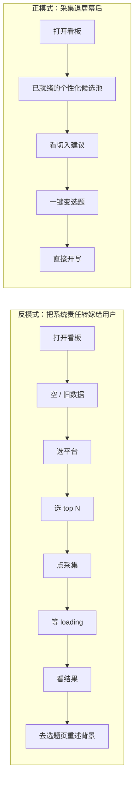
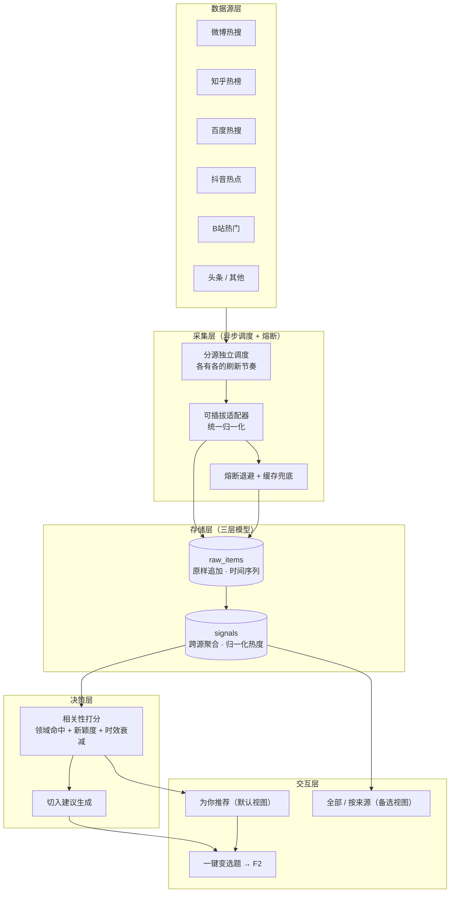
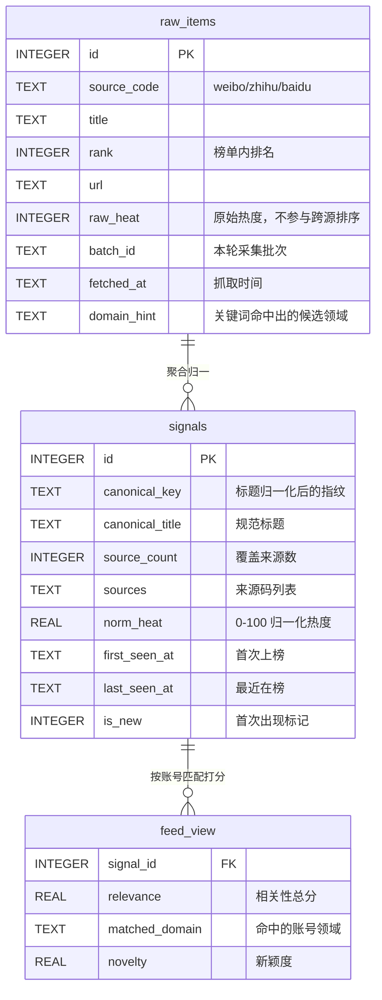

# 热点采集方案设计 V2（重新设计）

> 版本：V2.0.0 ｜ 日期：2026-10-14 ｜ 状态：设计稿（待评审）
> 说明：本文**不沿用**《热点采集改造计划》的思路，从"用户到底想要什么"重新推导。仍以《AI 自媒体内容创作助手》既有产品定位（PRD 1.1「热点感知—选题策划—文案生成—多平台适配」）为背景。

---

## 0. 先换位：一个懒惰博主的自述

> 我一天要写 3 条内容，我不想学任何新工具。

1. **"我根本想不起来打开你这个软件。"** 热点最有价值的时间是它刚起来的那两个小时，而我那会儿通常在忙别的。
2. **"我打开的时候，希望屏幕已经满了，不是让我点一个按钮。"** 让我点"采集"，就是让我当运维。
3. **"我不认识微博、知乎、百度。我只想知道今天有什么是我能写的。"** 让我勾选平台，是你没想清楚你要给我什么。
4. **"排第一的是明星八卦，跟我做科技号有什么关系？"** 全网热 ≠ 我的热。我要的是**我的领域里的热**。
5. **"我不在乎它排第几，我在乎我能不能写、写了会不会火。"** 榜单第一名往往是最难写的（大 V 都写了）。
6. **"昨天那条怎么还在？"** 我要的是**新的**，不是最热的。看过的热点对我是负债。
7. **"光给个标题没用，我得自己琢磨角度，那我还不如自己刷。"** 我要的是**一句"你可以这么写"**。
8. **"看完热点，我还得切页面、重新把背景描述一遍，太累了。"** 我要的是**点一下就开始写**。
9. **"最烦的是它告诉我'采集失败，0 条'。"** 我可以接受数据旧一点，但不能接受空屏。
10. **"别让我配什么 API 地址、什么 top N。配一次就够了，最好永远别配。"**

**从这 10 句里能提炼出的真实需求（按用户在意程度排序）：**

| 排序 | 用户要的 | 用户不要的 |
|---|---|---|
| 1 | 和我领域相关的热 | 全网榜单搬运 |
| 2 | 我没看过的新东西 | 昨天霸榜的老面孔 |
| 3 | 打开就有、永不空屏 | 空状态 + 采集按钮 |
| 4 | 一句话告诉我怎么用 | 一个裸标题 |
| 5 | 点一下就能开写 | 复制标题去别的页面重来 |
| 6 | 我不用做任何操作 | 勾平台、选 top N、配地址 |

> 一句话总结懒惰博主的心声：**"你别让我采集，你替我采集好、挑好、并告诉我怎么用。"**

---

## 1. 从"懒惰"反推的 6 条设计原则

| 编号 | 原则 | 反面（要避免的） |
|---|---|---|
| P1 | **采集是系统的事，不是用户的事** | 用户主动点"采集热点" |
| P2 | **相关性优先于覆盖面** | 把全网榜单原样搬进看板 |
| P3 | **新鲜度优先于热度** | `ORDER BY heat DESC`，老热点永久霸榜 |
| P4 | **可创作性优先于排名** | 展示排名数字，不展示切入角度 |
| P5 | **永不空白**：多源 + 缓存 + 降级 | 单源失败即空状态 |
| P6 | **闭环零跳转**：热点 → 选题 → 文案 | 看完热点就走进死胡同 |

---

## 2. 核心重构：把"采集"从用户手里拿回来

这是本方案与"加一个采集按钮"类方案最根本的分歧：**用户要的不是"能采集"，而是"已经采好了"。**



正模式里用户仍然保留**控制感**，只是不再承担**操作成本**：

- 顶部不显示"采集热点"按钮，显示 **数据新鲜度**："3 分钟前更新 · 覆盖 6 个来源" + 一个低权重的刷新图标（带最小间隔限制）。
- 后台按各来源自身的更新节奏自动采集，用户零操作。
- 用户主动刷新是**可选加速**，不是**必经步骤**。

---

## 3. 方案总览



---

## 4. 数据模型：三层，而不是一张表

现有实现把"抓到的条目"直接当"看板数据"，一张表既当原始记录又当展示数据，导致三个问题无法在 SQL 层面解决：**跨源热度不可比、老热点无法退榜、跨平台同一话题重复展示**。

三层模型（概念三层，落地两张表 + 一个查询）分别解决：



| 层 | 职责 | 解决的问题 |
|---|---|---|
| **raw_items**（追加式，不覆盖） | 原样落地每轮抓取结果 | ① 保留时间序列 → 才能算"首次出现/持续在榜"；② 高度不可比的问题被隔离在这一层 |
| **signals**（聚合） | 跨来源合并同一话题，热度**归一化** | ③ 微博"热"≠B站播放量 → 只做 0-100 归一化 + 来源覆盖数加权；④ 跨平台同名话题不再重复展示 |
| **feed_view**（查询/视图） | 按账号领域打分排序 | ⑤ 从"榜单"变成"给我的候选池" |

**生命周期：自然退榜，而不是靠人工清理。**
`last_seen_at` 距今超过阈值（如 24h）即视为已退榜，不出现在 Feed 中。raw 层数据保留（用于趋势分析），但**看板永远不会出现"上周的热点"**。这比"额外写一段下架逻辑"更稳，因为它是模型自带的性质。

**去重键（这里是最容易被做错的地方）：**
- raw 层唯一键 = `(source_code, title, 采集日)` —— 同源同标题同日只留一条，跨平台同名**各自保留**。
- signal 层指纹 = `hash(标题归一化)`，归一化 = 去 `#` 话题符 / 去 emoji / 去空白与标点 / 全角转半角。
- ⚠️ **绝不能**用 `title + 固定来源名` 做唯一键（来源名恒定等于只按标题去重，会误合并跨平台话题、且标题一变就新增行）。

---

## 5. 决策层：从"看榜"到"给我的"

这是"懒惰博主"最在意的部分。默认视图的排序**不是热度，而是"这条值不值得我今天写"**：

```
relevance = 0.30 × 领域命中(domain_match)      // 与账号 domains / positioning 的关键词与语义匹配
          + 0.25 × 新颖度(novelty)              // 首次出现且最近 24h 内 ↑ 权重最高
          + 0.20 × 来源覆盖度(source_count)      // 多平台同时在讨论 = 真趋势，单平台孤例降权
          + 0.15 × 归一化热度(norm_heat)         // 只在同源内可比
          + 0.10 × 可创作性(creatability)        // 有对立观点 / 有数字 / 有具体场景 → 好写
```

- **权重全部外置可调**（配置项），不写死在代码里。
- **可解释**：前端每条卡片可以展示"为什么推荐给你"——"命中你的领域：科技 · 6 个平台在讨论 · 2 小时前首次出现"。可解释性直接决定用户信不信这个推荐。
- 领域命中用**轻量关键词表 + positioning 文本相似度**即可，不需要训练分类模型——可解释、可人工维护、零依赖。

**可创作性增强（把热点变成"原料"而不是"标题"）：**
每条热点卡片附一行 **切入建议**，例如：

> 端侧大模型本地运行成为新热点
> *建议角度：反着写「为什么我不建议现在买 AI 手机」——争议点比科普更容易起量。*

生成本身可复用现有 LLM 链路（`api/core/rag_pipeline.py` 已有 `generate_topics` 与提示词体系），只需加一个热点级的最小 prompt。

**闭环：** 卡片上的"用它做选题"直接携带热点上下文调用 `/api/topics/generate`，落到 F2，**用户不需要重新描述背景**（现在 `topics.py` 是按 domain 取热点，需要改为支持 `hotspot_id` 直传）。

---

## 6. 采集层：调度是"新鲜度契约"，不是按钮

| 设计点 | 做法 | 原因 |
|---|---|---|
| 分源独立节奏 | 热搜类 10min、社区类 30min、低频源 60min | 不同平台更新速度差一个数量级，统一 60min 要么浪费要么不够新 |
| 熔断退避 | 单源连续失败 3 次 → 指数退避，不影响其他源 | 免费源不稳定是常态，不能让一个源拖垮整体 |
| 部分成功 | 返回 `{采集数, 失败源列表}`，前端只提示降级 | 6 个源里挂了 1 个，用户不该看到"失败" |
| 三级兜底 | ①实时源 → ②上次成功缓存（标注"数据为 X 小时前"）→ ③内置种子 | **Feed 空屏率目标 = 0** |
| 不撒谎 | 缓存/种子数据必须在 UI 上明确标注来源与时间 | 演示保真；用户知道自己在看什么 |
| 安全 | 采集端点需鉴权 + 最小间隔 + 单次来源数上限 | 写库 + 对外请求的端点不能裸奔 |

---

## 7. 交互设计：懒人版热点看板

```
┌──────────────────────────────────────────────────────────┐
│ 热点看板        3 分钟前更新 · 6 个来源        [↻]        │  ← 新鲜度，不是"采集"按钮
├──────────────────────────────────────────────────────────┤
│ [为你推荐 8]  [全部]  [科技] [财经] …        ← 默认第一个 │  ← 默认个性化，平台维度降为备选
├──────────────────────────────────────────────────────────┤
│ ┌──────────────────────────────────────────────────────┐ │
│ │ 新 · 科技 · 6 个平台   首次上榜 2h 前                 │ │
│ │ 端侧大模型本地运行成为新热点                          │ │
│ │ 建议角度：反着写「为什么我不建议现在买 AI 手机」…     │ │
│ │                    [用它做选题]  [看原文 ↗]           │ │
│ └──────────────────────────────────────────────────────┘ │
│ ┌──────────────────────────────────────────────────────┐ │
│ │   科技 · 3 个平台      在榜 1 天                      │ │
│ │ …                                                     │ │
└──────────────────────────────────────────────────────────┘
```

关键变化与理由：

| 变化 | 理由 |
|---|---|
| "采集热点"按钮 → "N 分钟前更新 + 刷新图标" | 用户要结果，不要流程（P1） |
| 默认视图是"为你推荐"而非"全榜" | 用户要的是"我的热"，不是"全网热"（P2） |
| 平台从"筛选器"降为"备选视图" | 平台是数据源的属性，不是用户的分类习惯（P2） |
| 卡片显示"新 / 首次上榜 X 小时前" | 新颖度是用户最在意的排序依据（P3） |
| 卡片带"建议角度" + "用它做选题" | 把看榜变成开工（P4/P6） |
| 领域标签由系统自动判定后展示（可纠正） | 用户不需要手选平台，但可以纠正系统的领域判断 |

---

## 8. 与现有工程的落地映射

| 现有位置 | 改动 |
|---|---|
| `api/core/hotspot_collector.py` | 重写为"调度 + 适配器注册表 + 熔断"；`_MOCK_SOURCES` 降级为最后一级兜底种子 |
| `db/schema.sql` | 新增 `raw_items`、`signals` 两表 + 索引；`hotspots` 保留但语义下沉（或迁移后废弃） |
| `api/routers/hotspots.py` | `GET` 增加 `view=feed\|all`、`domain`、`new_only` 参数；新增 `POST /refresh`（**非** `/collect`，语义是"加速刷新"且带间隔限制 + 鉴权） |
| `api/routers/topics.py` | `GenerateReq` 增加 `hotspot_id`，支持"从热点一键生成选题" |
| `frontend/src/pages/Hotspots.tsx` | 默认视图改为个性化 Feed；去掉平台多选与 top N；新增新鲜度条、"新"标记、建议角度、一键选题 |
| `frontend/src/api/types.ts` | `Hotspot` 增加 `signal_id`、`is_new`、`first_seen_at`、`source_count`、`suggestion`；**不要**复用已有的 `PLATFORMS`（那是发布平台码，语义不同），热榜来源另用 `HOT_SOURCES`（值为 `weibo/zhihu/...` 码 + 中文 label） |
| 文档 | `docs/PRD.md` F1.4 验收标准需同步为"自动采集 + 个性化候选池"；`docs/架构设计.md` 热点采集流需重画 |

---

## 9. 指标：北极星 + 支撑

> 老问题不是"没有指标"，而是**指标定义在系统侧**（采集成功率、行数不增长）。系统指标全绿、用户依然觉得没用，是这类功能最常见的死法。

**北极星指标：Feed 采纳率** = 从热点看板进入选题/生成的比例。
它同时回答了两个问题：数据是否相关、闭环是否顺畅。

| 类型 | 指标 | 目标 |
|---|---|---|
| 北极星 | Feed 采纳率 | 建立基线后逐版提升 |
| 相关性 | 默认视图中与账号领域相关的条目占比（人工抽检） | ≥ 80% |
| 新颖度 | 默认视图中"新条目"占比 | ≥ 60% |
| 时效 | 看板头部数据年龄 | ≤ 30 分钟 |
| 可用性 | **Feed 空屏率** | = 0 |
| 稳定性 | 采集成功率（部分成功口径） | ≥ 95% |
| 效率 | 从"看到热点"到"产出首版文案"的中位时长 | 逐版下降 |
| 成本 | 单次采集端到端 P95 | ≤ 5s（≤6 源并发） |

---

## 10. 分期路线

| 期 | 目标 | 内容 |
|---|---|---|
| **一期：先解决"假"**（必须） | 数据真实、可用 | 可插拔适配器接入真实源；三层数据模型；去重键与退榜机制；三级兜底；新鲜度展示；采集端点鉴权与频控 |
| **二期：再解决"懒"**（核心价值） | 用户零操作、只看相关的 | 相关性打分 + 默认"为你推荐"视图；"新"标记；切入建议；一键变选题闭环；刷新图标替代采集按钮 |
| **三期：再解决"更准"**（增强） | 更聪明 | 跨源语义聚类提升 signal 质量；趋势预测（上升/衰减）；按账号历史行为的个性化排序 |
| 可选 | 主动触达 | 每日热点日报（站内/邮件）；仅当用户开启 |

> 一期必须做，因为不做就是在假数据上做交互设计。二期才是这个功能的**价值来源**——一期只是把它变成"真的"，二期才把它变成"有用的"。

---

## 11. 取舍与风险（诚实说明）

| 取舍 | 说明 |
|---|---|
| 三层模型 vs 单表 | 三层让"退榜/归一化/去重"变成模型自带的性质，而不是散落各处的补丁。代价是初期多两张表和一次迁移。**建议接受**——这三个问题用单表方案都会在半年后返工。 |
| 个性化排序 vs 简单热度排序 | 个性化更难做对，但"按热度排全网榜单"已经被证明用户不买单。**建议做**，但用可解释的轻量规则，不引入模型依赖。 |
| 自动刷新 vs 用户控制 | 用户会担心"数据是不是旧的"。用**新鲜度可见**替代**手动触发**，比强迫用户点按钮更好。 |
| 删除平台多选 | 会让"我想逛某个平台"的用户失去入口 → 保留为备选视图即可，不作为主流程。 |
| 风险 | 免费聚合源的稳定性与合规性（需频控、来源署名、外链 `rel="noopener"`）；自托管实例（如 DailyHot）部署在海外节点会有可达性风险，建议国内节点或先跑通多适配器再接自托管。 |

---

## 12. 一页纸总结

1. **不要让用户点"采集"。** 采集是系统的责任，用户要的是"已经采好的、只属于我这个账号的、带切入建议的候选池"。
2. **不要把榜单搬进看板。** 从"全网最热"改成"我的领域里最值得写"，相关性 > 覆盖面。
3. **新 > 热。** 用"首次上榜时间"排序，而不是热度绝对值；用 `last_seen_at` 让老热点自然退榜。
4. **三层数据模型**（raw → signal → feed），让跨源热度可比、老热点退场、同一话题不重复。
5. **永不空屏 + 不撒谎。** 三级兜底，降级数据必须标注来源与时间。
6. **看板必须通向开工。** 每条热点带一句"建议角度"，点一下就能变成选题、进入生成。
7. **指标定义在用户侧。** 北极星是 Feed 采纳率，不是采集成功率。
